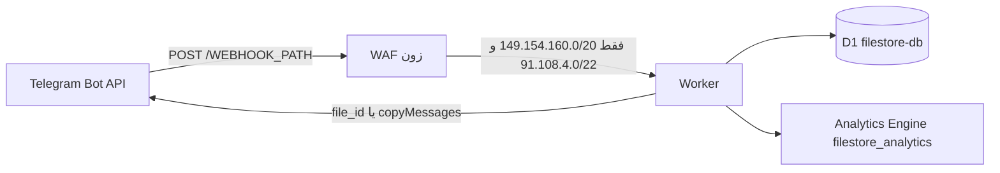

# ربات فایل‌استور تلگرام

[English documentation](./README.md)

نسخهٔ چندصفحه‌ای همین راهنما در [`docs/fa/`](./docs/fa/index.md) است و روی GitHub Pages منتشر می‌شود. این فایل همان متن، در یک صفحه، می‌ماند.

ربات فایل‌استور تلگرام برای پلن رایگان Cloudflare Workers و یک پایگاه D1. نسخه **۱.۰.۰**. بدون VPS، بدون محصول پولی کلودفلر، و بدون عبور بایت فایل از داخل Worker.

> [!TIP]
> **علاقه‌مند به نسخه سرورلس تلگرام (@tgcloud/bot) هستید؟**
> یک مخزن مستقل و اختصاصی برای بستر سرورلس بومی تلگرام در دسترس است: [`telegram-uploader-bot`](https://github.com/AZiPA/telegram-uploader-bot) که بدون نیاز به هیچ‌گونه سرور یا زیرساخت ابری جانبی اجرا می‌شود.

این راهنما دفترچهٔ راه‌اندازی است: Actions چطور D1 را می‌سازد و وصل می‌کند، توکن API دقیقاً چه مجوزهایی می‌خواهد، دامنهٔ اختصاصی چطور بعد از هر دیپلوی سر جایش می‌ماند، و خود ربات چطور اداره می‌شود.


---

## فهرست

1. [معرفی و معماری بدون هزینه](#۱-معرفی-و-معماری-بدون-هزینه)
2. [آماده‌سازی Cloudflare](#۲-آماده‌سازی-cloudflare)
3. [رازهای GitHub Actions](#۳-رازهای-github-actions)
4. [ثبت وب‌هوک](#۴-ثبت-وبهوک)
5. [دامنهٔ اختصاصی و سخت‌سازی WAF](#۵-دامنهٔ-اختصاصی-و-سختسازی-waf)
6. [پیکربندی (`src/config.ts` و `/settings` زنده)](#۶-پیکربندی-srcconfigts-و-settings-زنده)
7. [دستورها و نقش‌ها](#۷-دستورها-و-نقشها)

---

## ۱. معرفی و معماری بدون هزینه

یک Worker به نام `telegram-filestore-bot` آپدیت‌های تلگرام را می‌گیرد، فقط با یک پایگاه D1 به نام `filestore-db` کار می‌کند، و شمارنده‌ها را به مجموعهٔ Analytics Engine با نام `filestore_analytics` می‌فرستد. فایل از Worker رد نمی‌شود. تحویل یا با `file_id` تلگرام است، یا اگر `STORAGE_CHANNEL_ID` تنظیم شده باشد با `copyMessages` از کانال بایگانی.



### سقف پلن رایگان

بازنشانی سهمیه ساعت ۰۰:۰۰ به وقت UTC است و این عددها برای کل حساب‌اند، نه فقط این ربات.

| منبع | سقف رایگان | خرج این ربات |
|---|---|---|
| درخواست Worker | ۱۰۰٬۰۰۰ در روز | هر آپدیت وب‌هوک و هر تیک cron. تریگر `* * * * *` به‌تنهایی ۱۴۴۰ درخواست در روز است. |
| CPU | ۱۰ میلی‌ثانیه CPU همگام در هر درخواست (خطای ۱۱۰۲) | زمان انتظار برای تلگرام و D1 جزو این بودجه نیست. تحویل چندثانیه‌ای مجاز است. |
| حافظه | ۱۲۸ مگابایت | بافر فایل ساخته نمی‌شود. |
| زیردرخواست خارجی | ۵۰ در هر فراخوانی | بودجهٔ Bot API داخل کد ۳۵ است. |
| اتصال خروجی همزمان | ۶ | بررسی عضویت اجباری در موج‌های حداکثر ۶تایی. |
| حجم اسکریپت / استارت | ۶۴ مبی‌بایت غیرفشرده، استارت زیر ۱ ثانیه | استارت سرد `getMe` نمی‌زند (پایین‌تر). |
| ردیف خوانده‌شدهٔ D1 | ۵٬۰۰۰٬۰۰۰ در روز | **ردیف اسکن‌شده، نه ردیف برگشتی.** |
| ردیف نوشته‌شدهٔ D1 | ۱۰۰٬۰۰۰ در روز | هر بسته یک ردیف است. |
| فضای D1 | ۵ گیگابایت | |
| نوشتن Analytics Engine | ۱۰۰٬۰۰۰ نقطه در روز | شمارندهٔ دانلود و سیگنال خطای نادر. |

اگر سقف درخواست پر شود، کلودفلر **خطای ۱۰۲۷ را لبه‌ای** برمی‌گرداند. Worker اصلاً اجرا نمی‌شود و نمی‌تواند به تلگرام ۲۰۰ بدهد. تلگرام ساعت‌ها دوباره می‌فرستد و می‌تواند روز UTC بعد را هم بسوزاند. کار اپراتور در بخش [ثبت وب‌هوک](#۴-ثبت-وبهوک) است: `drop_pending_updates`، یا برداشتن وب‌هوک، تا ۰۰:۰۰ UTC.

بلوک `[observability]` در [wrangler.toml](wrangler.toml) کامنت می‌ماند. لاگ و تریس Workers لازم نیست و نباید با دیپلوی روشن شود.

### یک ردیف JSON، و کاهش ۹۶ درصدی نوشتن

`bundles` برای هر کد اشتراک یک ردیف است. فرادادهٔ حداکثر **۲۵** فایل داخل ستون متنی `items` به شکل آرایهٔ JSON است (`file_id`، `file_unique_id`، `type`، و در صورت وجود نام، اندازه، mime، و `storage_message_id`). جدول `bundle_items` و ستون `bundles.id` وجود ندارد.

یک بستهٔ ۲۵فایلی **یک** نوشتن D1 است، نه ۲۵ نوشتن ردیف فرزند. یعنی `1 − 1/25 = 96%` نوشتن کمتر نسبت به مدل «هر فایل یک ردیف»، در بزرگ‌ترین اندازه‌ای که ربات می‌پذیرد. ویرایش بستهٔ موجود هم هنوز یک نوشتن است (CAS پایین)، نه یک نوشتن به‌ازای هر فایل. حذف بسته یک batch دوستوری است و `user_downloads` را پاک **نمی‌کند**. آن جدول دفتر سهمیهٔ روزانه و آمار ۷روزه است؛ پاک کردنش سهمیه را پس می‌دهد و بودجهٔ نوشتن را هدر می‌دهد.

```sql
-- دقیقاً همان رشتهٔ ذخیره‌شده، نه JSON که دوباره سریال شده باشد
UPDATE bundles
SET items = ?
WHERE code = ? AND items = ?;
```

`bundles` ستون `created_at` دارد، نه `updated_at`. اگر `meta.changes` صفر باشد، درخواست دیگری سند را عوض کرده؛ هندلر یک‌بار دوباره می‌خواند یا متوقف می‌شود. با حذف آخرین فایل، خود بسته و ردیف‌های `bundle_votes` آن حذف می‌شوند. `items = '[]'` باقی نمی‌ماند.

فهرست، جست‌وجو، و آمار ستون `bundles.items` را انتخاب نمی‌کنند. تعداد فایل با `json_array_length(items)` است. آمار مدیر ۵ دقیقه در همان isolate کش می‌شود.

### استخر شش سوکت

سکو در هر فراخوانی فقط ۶ اتصال خروجی همزمان اجازه می‌دهد. `Promise.all` روی بیش از ۶ تا `getChatMember` امن نیست؛ سوکت اضافه قابل‌اتکا صف نمی‌شود. بررسی عضویت کانال‌های جوین اجباری در موج‌های حداکثر ۶تایی اجرا می‌شود و روی ۴۲۹، تایم‌اوت، یا خطای شبکه بسته می‌ماند (کاربر «عضو نشده» فرض می‌شود و موج بعدی نمی‌رود). این تماس‌ها جزو بودجهٔ ۳۵تایی Bot API هستند. از داخل درخواست تأیید کاربر، به مالک یا کانال لاگ هشدار فرستاده نمی‌شود.

تحویل نوع‌های مختلف با `file_id` ترتیبی است (یک سوکت). `copyMessages` و `deleteMessages` فقط وقتی استفاده می‌شوند که کانال بایگانی یا صف حذف بتواند شناسهٔ پیام‌ها را یکجا بفرستد.

### استارت سرد بدون `getMe`

راز `BOT_ID` وجود **ندارد**. در هر isolate تابع `botIdFromToken()` در [src/shared/formatters.ts](src/shared/formatters.ts) شناسهٔ عددی را با عبارت `/^(\d+):/` از `BOT_TOKEN` می‌خواند. توکن را `split` نمی‌کند و لاگ هم نمی‌کند.

اگر هم این شناسه باشد و هم `BOT_USERNAME`، [src/bot.ts](src/bot.ts) کتابخانهٔ grammY را با `botInfo` ایستا می‌سازد (`id`، `username`، `first_name`، و پرچم‌های `DEFAULT_BOT_INFO`). در این حالت `isInited()` از همان اول درست است و مسیر وب‌هوک `getMe` نمی‌زند. اگر یکی از این دو نباشد، grammY به `init()` برمی‌گردد و روی isolate سرد یک زیردرخواست اضافه می‌شود. `BOT_USERNAME` را بگذارید.

### نقش، سهمیه، قرارداد وب‌هوک

هر کاربر در D1 فقط یک نقش دارد: `owner`، `superadmin`، یا `admin`. `MAX_ADMINS` (۱۰) فقط ردیف‌های `role = 'admin'` را می‌شمارد. شناسهٔ عددی `OWNER_ID` همیشه مالک است، حتی پیش از ساخته شدن ردیف.

| نقش | سقف روزانه | سقف هر لینک |
|---|---|---|
| مالک | هیچ (ردیف دفتر نوشته نمی‌شود) | هیچ |
| مدیر | ۱۵۰ | ۲۰ |
| ویژه، منقضی‌نشده | `daily_download_limit × ۵` | `file_daily_limit × ۳` |
| بقیه | `daily_download_limit` (پیش‌فرض ۱۰) | `file_daily_limit` (پیش‌فرض ۳) |

تاریخ‌ها `YYYY-MM-DD` به وقت UTC هستند. تریگرهای `trg_user_downloads_limit_insert` و `_update` ترمز کاربر عادی‌اند (پیش‌فرض ۱۰ در روز) و ردیف‌های `admins` و VIP منقضی‌نشده را **معاف** می‌کنند. عددهای مدیر و VIP در جدول بالا قبل از درج، در خود برنامه اعمال می‌شوند.

مسیر اشتباه یا متد غیر از POST: **۴۰۴**. مقدار اشتباه هدر `X-Telegram-Bot-Api-Secret-Token`: **۴۰۳**. آپدیت رسیدگی‌شده، از جمله خطایی که ربات طبقه‌بندی کرده: **۲۰۰**، تا تلگرام همان آپدیت را به پایگاه ازکارافتاده شلیک نکند.

---

## ۲. آماده‌سازی Cloudflare

این کارها یک‌بار، در همان حسابی که Worker مال آن است. شناسهٔ پایگاه وارد گیت نمی‌شود.

### ۲.۱ پایگاه D1 با نام `filestore-db`

جاب دیپلوی، اگر پایگاه وجود نداشته باشد، آن را در اولین اجرا با `primary_location_hint: weur` (اروپای غربی) می‌سازد. ساختن دستی در داشبورد هم کار می‌کند؛ پایگاه موجود دوباره ساخته نمی‌شود و جاب فقط UUID آن را برمی‌دارد. `npx wrangler d1 create` استفاده نمی‌شود.

1. ساخت در داشبورد اختیاری است. اگر خودتان بسازید، جاب همان UUID را برمی‌دارد و مکان پایگاه را عوض نمی‌کند.
2. اگر نسازید، Actions با `POST /accounts/{account_id}/d1/database` و `primary_location_hint: region` (پیش‌فرض `weur` — اروپای غربی) می‌سازد. این hint فقط هنگام ساخت پایگاه‌های جدید است، نه jurisdiction.
3. در گیت `database_id = "PLACEHOLDER_D1_ID"` می‌ماند. UUID فقط روی رانر نوشته می‌شود.
4. [schema.sql](schema.sql) را دستی نچسبانید. جاب `wrangler d1 execute` را می‌زند.

جدول‌ها: `bundles`، `admin_sessions`، `bundle_votes`، `deletion_queue`، `admins` (نقش `admin` / `superadmin` / `owner`)، `vips`، `user_quotas` (فقط بن و اخطار، نه شمارندهٔ دوم دانلود)، `user_downloads`، `system_config`، `force_channels`، به‌اضافهٔ ایندکس‌ها و تریگر سقف روزانه. ردیف‌های پیش‌فرض تنظیم: تعمیرات خاموش، سقف روزانه ۱۰، سقف هر لینک ۳، حذف خودکار ۰، زبان `en`، محافظت سراسری خاموش. ردیف `log_channel_id` پیش‌فرض ندارد؛ تا وقتی مقصدی تنظیم نشود لاگ تلگرام خاموش است.

### ۲.۲ کار GitHub Actions با این پایگاه

[`.github/workflows/deploy.yml`](.github/workflows/deploy.yml) روی هر push به `main` و روی **Run workflow** اجرا می‌شود. جاب Node ۲۴ است و `npm install --legacy-peer-deps` می‌زند، نه `npm ci`، سپس:

1. نام پایگاه را از `wrangler.toml` می‌خواند، مگر فرم ورک‌فلو نام دیگری بدهد.
2. با REST لیست می‌گیرد و ردیفی که `name` دقیقاً یکی باشد را نگه می‌دارد.
3. اگر نبود، با مقدار اشارهٔ مکان تفکیک‌شده (پیش‌فرض `"weur"` یا مقدار ورودی `custom_db_region` / متغیر مخزن `D1_LOCATION`) پایگاه را می‌سازد. اگر همزمان وجود داشته باشد، دوباره لیست می‌گیرد و همان UUID را استفاده می‌کند. خطای لیست یعنی شکست جاب، نه حدس.
4. UUID را ماسک می‌کند و اگر UUID معتبر نباشد ادامه نمی‌دهد.
5. `database_id` را فقط روی رانر می‌نویسد. در گیت placeholder می‌ماند.
6. `schema.sql`، بعد `ALTER` ستون `role`، بعد upsert مالک.
7. `wrangler deploy` و تزریق راز. `STORAGE_CHANNEL_ID` و `LOG_CHANNEL_ID` و `BOT_FIRST_NAME` فقط اگر خالی نباشند تزریق می‌شوند.

`npx wrangler d1 create --location=weur` عمداً استفاده نمی‌شود: خروجی `--json` با بنر قاطی می‌شود، روی رانر بدون TTY پرسش مکان می‌پرسد، و `--location` همان `primary_location_hint` در API نیست.

ورودی‌های `custom_db_name`، `custom_db_region`، و `custom_worker_name` اختیاری‌اند. خالی بگذارید تا مقادیر پیش‌فرض (`filestore-db`، `weur`، و `telegram-filestore-bot`) اعمال شوند. نام سفارشی پایگاه اگر از قبل نباشد در منطقهٔ مشخص‌شده ساخته می‌شود.

#### انتخاب منطقهٔ D1 و نگاشت مراکز داده (DC) تلگرام

پایگاه دادهٔ D1 کلودفلر از ۶ اشارهٔ مکان پشتیبانی می‌کند: `weur` (اروپای غربی)، `eeur` (اروپای شرقی)، `enam` (شرق آمریکای شمالی)، `wnam` (غرب آمریکای شمالی)، `apac` (آسیا-اقیانوسیه)، و `oc` (اقیانوسیه).

**چرا `weur` (اروپای غربی) پیش‌فرض است:**
- درگاه مرکزی Bot API تلگرام (`api.telegram.org`)، سیستم‌های ارسال وب‌هوک (`149.154.160.0/20` و `91.108.4.0/22`)، و دیتاسنترهای اصلی اروپای تلگرام (**DC2 و DC4**) در **آمستردام، هلند (اروپای غربی)** میزبانی می‌شوند.
- آپدیت‌های ارسالی تلگرام به نزدیک‌ترین مراکز لبه‌ای کلودفلر در اروپای غربی برخورد کرده و ایزوله‌های Worker در همان منطقه اجرا می‌شوند. قرار گرفتن D1 در `weur` باعث همجواری Worker، پایگاه D1 و سرورهای تلگرام شده و تأخیر رفت‌وبرگشت (RTT) و زمان اجرای درخواست‌ها را به حداقل می‌رساند.

**راهنمای نگاشت دیتاسنترهای تلگرام:**
اگر حساب سازندهٔ ربات، مخاطبان اصلی، یا کانال آرشیو فایل‌های شما در دیتاسنتر دیگری از تلگرام قرار دارد، می‌توانید هنگام ساخت پایگاه دادهٔ جدید مقدار `custom_db_region` (یا متغیر مخزن `D1_LOCATION`) را متناسب با آن تنظیم کنید:
- **DC2 / DC4 (اروپا — آمستردام):** `weur` (پیش‌فرض — پیشنهادشده برای اکثر ربات‌ها) یا `eeur`
- **DC1 / DC3 (آمریکا — میامی):** `enam` (یا `wnam`)
- **DC5 (آسیا-اقیانوسیه — سنگاپور):** `apac` (یا `oc` برای اقیانوسیه)

> [!NOTE]
> کلودفلر پارامتر `primary_location_hint` را **تنها هنگام ساخت اولیهٔ پایگاه داده** اعمال می‌کند. پایگاه دادهٔ موجود همان‌طور که هست استفاده می‌شود و تغییر ورودی‌ها نمی‌تواند پایگاه موجود را به منطقهٔ دیگری منتقل کند.

### ۲.۳ مجموعهٔ Analytics Engine با نام `filestore_analytics`

این مجموعه را دستی نسازید و نامش را عوض نکنید.

[wrangler.toml](wrangler.toml) از قبل این را دارد:

```toml
[[analytics_engine_datasets]]
binding = "FILESTORE_ANALYTICS"
dataset = "filestore_analytics"
```

Workers Analytics Engine مجموعه را اولین باری می‌سازد که Worker روی این binding متد `writeDataPoint` را صدا بزند. خود دیپلوی binding مجوز Analytics جدا نمی‌خواهد. نام binding یعنی `FILESTORE_ANALYTICS` و نام مجموعه یعنی `filestore_analytics` ثابت‌اند.

بعد از اولین نوشتن واقعی، مجموعه در داشبورد زیر **Workers & Pages** و **Analytics** → **Workers Analytics Engine** دیده می‌شود. اگر بخواهید با SQL API بخوانیدش (`POST /accounts/<id>/analytics_engine/sql`)، آن توکن خواندن باید **Account Analytics Read** داشته باشد. توکن دیپلوی برای نوشتن نقطه‌ها این مجوز را لازم ندارد.

بلوک `[observability]` را از کامنت درنیاورید. آن بلوک لاگ و تریس Workers است، نه این مجموعه.

### ۲.۴ ساخت `CLOUDFLARE_API_TOKEN` از قالب Edit Cloudflare Workers

داشبورد → **My Profile** → **API Tokens** → **Create Token** → قالب **Edit Cloudflare Workers** → **Use template**.

خود قالب (جدول قالب کلودفلر، به‌روزرسانی ۲۰۲۶-۰۴-۲۰) این‌ها را دارد:

| مجوز قالب | سطح | برای این مخزن لازم است؟ |
|---|---|---|
| Workers Scripts → Write | حساب | بله. `wrangler deploy`، `wrangler secret put`، `wrangler secret bulk`. خود ردیف از قبل **Write** است. دستش نزنید. |
| Workers Routes → Write | زون | بله، به‌محض دیپلوی دامنه یا route اختصاصی. بماند، و زون را به زون ربات محدود کنید. |
| Account Settings → Read | حساب | بله. رانگلر حساب را می‌خواند. |
| User Details → Read | کاربر | بله. نگه دارید. |
| User Memberships → Read | کاربر | بله. حتی با وجود `CLOUDFLARE_ACCOUNT_ID` نگه دارید. رانگلر هنوز عضویت را حل می‌کند. |
| Workers KV Storage → Write | حساب | نه. این ربات KV ندارد. ماندنش ضرر ندارد. |
| Workers R2 Storage → Write | حساب | نه. R2 ندارد. ماندنش ضرر ندارد. |
| Workers Tail → Read | حساب | نه. ورک‌فلو tail نمی‌زند. ماندنش ضرر ندارد. |

**D1 را زیر Account اضافه کنید.** داخل قالب نیست. در صفحهٔ توکن، زیر **Account Resources**، **+ Add more** را بزنید. منوی مجوز فقط **Read** و **Write** دارد، درست مثل ردیف قالب که `Workers Scripts` → `Write` است. گزینه‌ای به نام **D1 Edit** در این منو نیست. دنبالش نگردید.

| چه را بزنید | چرا |
|---|---|
| Account → **D1** → **Write** | لازم است. list/create از REST در جاب دیپلوی، و `wrangler d1 execute` برای `schema.sql`، دستور `ALTER`، و seed مالک. |
| Account → **D1** → **Read** | اختیاری. اگر می‌خواهید همین توکن کوئری فقط-خواندنی D1 هم بزند اضافه کنید. مجوزی که این دیپلوی لازم دارد **Write** است. |
| Zone → **DNS** → **Write** (فقط زون ربات) | اگر دیپلویی که دامنهٔ اختصاصی اعلام کرده نتواند رکورد DNS پروکسی‌شده را بسازد، این را اضافه کنید. Custom Domain معمولاً وقتی **Workers Routes → Write** روی زون باشد رکورد را خودش می‌سازد. اگر API خطای مجوز DNS داد، اینجا **Write** را اضافه کنید؛ سراغ Global API Key نروید. |
| Account → **Account Analytics** → **Read** | اختیاری. فقط برای پرس‌وجوی SQL روی `filestore_analytics`. برای دیپلوی یا نوشتن نقطه لازم نیست. |

**محدودهٔ منبع.** یک حساب، نه «همهٔ حساب‌ها». زون: فقط زونی که دامنهٔ ربات روی آن است، نه همهٔ زون‌های حساب. مجوز API Tokens Write ندهید و از Global API Key استفاده نکنید.

**اولین دیپلوی Workerی که هنوز وجود ندارد.** از مدل نقش Workers (۲۰۲۶-۰۹-۱۵)، `wrangler deploy` برای اسکریپت **جدید** به **Workers Admin** در سطح محصول نیاز دارد. دیپلوی اسکریپت **موجود**، و `wrangler secret put` / `secret bulk`، به **Workers Scripts → Write** نیاز دارند که از قبل در قالب هست. بستن D1 روی دیپلوی هم همان مجوز Workers Scripts را می‌خواهد. **D1 → Write** لازم است چون این ورک‌فلو مستقیم به D1 کوئری و مهاجرت می‌زند، نه صرفاً به‌خاطر وجود binding.

اگر اجرای اول گفت توکن حق ساختن اسکریپت را ندارد:

1. داشبورد → **Workers & Pages** → **Create** → نام را دقیقاً `telegram-filestore-bot` بگذارید (اسکریپت خالی کافی است)، **یا** برای همان اجرای اول Workers Admin سطح محصول را به توکن اضافه کنید.
2. ورک‌فلو را دوباره اجرا کنید. دیپلوی‌ها و تزریق راز بعدی روی **Workers Scripts → Write** می‌مانند.
3. بعد از وجود اسکریپت می‌توانید Workers Admin را بردارید، اگر نمی‌خواهید CI بتواند Worker را حذف کند.

**Analytics Engine و این توکن.** نوشتن‌ها هنگام اجرا از binding خود Worker می‌روند و از `CLOUDFLARE_API_TOKEN` استفاده نمی‌کنند. برای ساخته شدن مجموعه در اولین نوشتن، مجوز اضافه لازم نیست. توکن بدون **D1 → Write** روی `d1 list` / `d1 execute` می‌شکند، نه روی Analytics Engine. ساخت پایگاه، اگر نباشد، با همان توکن و REST انجام می‌شود. بخش ۲.۱.

توکن را یک‌بار کپی کنید و به‌عنوان راز گیت‌هاب `CLOUDFLARE_API_TOKEN` ذخیره کنید. این یک binding ورکر نیست و نباید در `wrangler.toml` یا `src/` نوشته شود.

### ۲.۵ پیدا کردن `CLOUDFLARE_ACCOUNT_ID`

داشبورد → **Workers & Pages** → پنل حساب سمت راست، یا هر نشانی داشبورد:

```text
https://dash.cloudflare.com/<ACCOUNT_ID>/workers/overview
```

`<ACCOUNT_ID>` یک شناسهٔ هگز ۳۲ نویسه‌ای است. آن را در `CLOUDFLARE_ACCOUNT_ID` بگذارید. ورک‌فلو همین نام را به رانگلر می‌دهد. از نظر رمزنگاری راز نیست، ولی در این مخزن عمداً راز Actions است تا commit نشود.

---

## ۳. رازهای GitHub Actions

مخزن → **Settings** → **Secrets and variables** → **Actions** → **New repository secret**.

`BOT_ID` راز **نیست** و نباید ساخته شود. شناسهٔ عددی هنگام اجرا از `BOT_TOKEN` درمی‌آید.

### لازم

| راز | کار |
|---|---|
| `CLOUDFLARE_API_TOKEN` | دیپلوی رانگلر، D1، و تزریق راز. بخش ۲.۴. |
| `CLOUDFLARE_ACCOUNT_ID` | حسابی که Worker و D1 در آن هستند. |
| `BOT_TOKEN` | از BotFather. داخل Worker تزریق می‌شود. لاگ نشود. پیشوند شناسه محلی خوانده می‌شود؛ بقیهٔ توکن جدا ذخیره نمی‌شود. |
| `BOT_USERNAME` | بدون `@`. همراه شناسهٔ مشتق‌شده، `getMe` را در استارت سرد حذف می‌کند. ورک‌فلو با خالی بودنش fail نمی‌شود؛ با این حال بگذاریدش. |
| `OWNER_ID` | شناسهٔ عددی تلگرام مالک. هر دیپلوی در `admins` با `role = 'owner'` seed می‌شود. زمان اجرا هم همین شناسه را مالک می‌داند، حتی اگر ردیف نباشد. |
| `WEBHOOK_PATH` | بخش مسیر محرمانه، بدون اسلش اول. Worker فقط `POST /<WEBHOOK_PATH>` را می‌پذیرد. مسیر قابل‌حدس (`webhook`، `bot`) یعنی تنها چیزی که Worker را پنهان کرده قانون WAF است. رشتهٔ بلند و تصادفی بگذارید. |
| `WEBHOOK_SECRET` | به‌عنوان `secret_token` به تلگرام ارسال و با هدر `X-Telegram-Bot-Api-Secret-Token` تطبیق داده می‌شود. الزام قطعی (fail-closed): ورک‌فلو CI‏ (`.github/workflows/deploy.yml`) در صورت نبود راز یا کمتر از ۱۶ نویسه بودن متوقف می‌شود؛ Worker‏ (`src/index.ts`) در صورت تنظیم نشدن یا ناهماهنگی هدر، کد HTTP 403 برمی‌گرداند. |

فهرستی که جاب پیش از تأمین D1 روی خالی بودنش قطع می‌شود: `WEBHOOK_PATH`، `BOT_TOKEN`، `OWNER_ID`، `CLOUDFLARE_API_TOKEN`، `CLOUDFLARE_ACCOUNT_ID`، و `WEBHOOK_SECRET` (در صورت نبود یا کمتر از ۱۶ نویسه بودن fail-closed می‌شود؛ Worker در صورت تنظیم نبودن یا عدم تطابق HTTP 403 می‌دهد). `BOT_USERNAME` برای مقداردهی اولیهٔ ایستای ربات همچنان لازم است.

### اختیاری

| راز | کار |
|---|---|
| `STORAGE_CHANNEL_ID` | شناسهٔ عددی کانالی که ربات در آن ادمین است (معمولاً `-100...`). هنگام آپلود هر فایل را با `copyMessage` آنجا کپی می‌کند و `storage_message_id` را نگه می‌دارد. تحویل بعداً `copyMessages` انبوه از همان کانال است. اگر راز نباشد، تحویل هر قلم را با `file_id` و یکی‌یکی می‌فرستد. در هیچ‌کدام از دو حالت بایت فایل از Worker رد نمی‌شود. |
| `LOG_CHANNEL_ID` | کانال پیش‌فرض اختیاری لاگ تلگرام (`-100…`). فقط زمانی استفاده می‌شود که `system_config.log_channel_id` خالی باشد. نبود راز + ردیف خالی D1 = لاگ تلگرام خاموش (بدون فراخوانی Bot API برای لاگ، بدون نوشتن لاگ، هیچ پیامی به `OWNER_ID` فرستاده نمی‌شود). دستور `/setlogchannel off` مقدار `off` را ذخیره کرده و بر این راز اولویت دارد. دستور `/setlogchannel owner` لاگ‌ها را به چت خصوصی مالک هدایت می‌کند. بازنشانی کارخانه تنها مسیری است که در صورت حل نشدن مقصد لاگ، به `OWNER_ID` بازمی‌گردد. |
| `BOT_FIRST_NAME` | نام نمایشی اختیاری که داخل `botInfo` ایستا می‌نشیند. اگر نباشد، نام استارت سرد `File Store Bot` از `DEFAULT_BOT_INFO` است. لازم نیست. ورک‌فلو فقط وقتی غیرخالی باشد تزریقش می‌کند. |

راز اختیاری خالی وارد `wrangler secret bulk` نمی‌شود و به‌صورت مقدار تهی push نمی‌شود.

رازهای زمان اجرای Worker فقط این‌ها هستند: `BOT_TOKEN`، `BOT_USERNAME`، `BOT_FIRST_NAME`، `WEBHOOK_PATH`، `WEBHOOK_SECRET`، `OWNER_ID`، `STORAGE_CHANNEL_ID`، `LOG_CHANNEL_ID`. `CLOUDFLARE_API_TOKEN` و `CLOUDFLARE_ACCOUNT_ID` روی گیت‌هاب می‌مانند.

---

## ۴. ثبت وب‌هوک

حداقل یک‌بار Worker را دیپلوی کنید تا دامنه جواب بدهد، بعد وب‌هوک را ثبت کنید. تلگرام باید این نشانی را صدا بزند:

```text
https://<YOUR_DOMAIN>/<WEBHOOK_PATH>
```

`<YOUR_DOMAIN>` دامنهٔ اختصاصی بخش ۵ است، نه `*.workers.dev`. `<WEBHOOK_PATH>` همان مقدار محرمانه است، بدون اسلش اضافه.

`max_connections` تعداد آپدیتی است که تلگرام همزمان هل می‌دهد. پیش‌فرض ۴۰ است. این ربات **۸** می‌گذارد: بودجهٔ روزانه ۱۰۰٬۰۰۰ درخواست است و cron از همین حالا ۱۴۴۰ تا را مصرف می‌کند. یک لینک عمیق وایرال با پیش‌فرض ۴۰ می‌تواند سهمیه را در یک بعدازظهر خالی کند. هشت اتصال برای یک ربات عمومی کوچک کافی است و نمی‌گذارد سیل، کل روز را در یک ساعت صف کند.

`allowed_updates` فقط `message` و `callback_query` است. ربات inline query، پست کانال، و نتیجهٔ نظرسنجی را هندل نمی‌کند. نوع اضافه باز هم Worker را بیدار می‌کند.

curl را ترجیح بدهید تا توکن در تاریخچهٔ مرورگر نماند. متغیرها را محلی عوض کنید. دستور را با مقدار واقعی commit نکنید.

```bash
curl -sS "https://api.telegram.org/bot${BOT_TOKEN}/setWebhook" \
  --data-urlencode "url=https://<YOUR_DOMAIN>/${WEBHOOK_PATH}" \
  --data-urlencode "secret_token=${WEBHOOK_SECRET}" \
  -d "max_connections=8" \
  --data-urlencode 'allowed_updates=["message","callback_query"]' \
  -d "drop_pending_updates=true"
```

همان فراخوانی در مرورگر (توکن در تاریخچه می‌ماند؛ روی دستگاه مشترک استفاده نکنید):

```text
https://api.telegram.org/bot<BOT_TOKEN>/setWebhook?url=https://<YOUR_DOMAIN>/<WEBHOOK_PATH>&secret_token=<WEBHOOK_SECRET>&max_connections=8&allowed_updates=%5B%22message%22%2C%22callback_query%22%5D&drop_pending_updates=true
```

پاسخ درست شامل `"ok": true` و `"description": "Webhook was set"` است.

### بررسی

```bash
curl -sS "https://api.telegram.org/bot${BOT_TOKEN}/getWebhookInfo"
```

```text
https://api.telegram.org/bot<BOT_TOKEN>/getWebhookInfo
```

این‌ها را چک کنید:

- `url` برابر `https://<YOUR_DOMAIN>/<WEBHOOK_PATH>` باشد
- `has_custom_certificate` برابر false باشد (گواهی لبهٔ کلودفلر عمومی و معتبر است)
- بعد از یک `/start` آزمایشی، `pending_update_count` صفر باشد یا رو به کاهش
- `max_connections` برابر ۸ باشد
- `allowed_updates` برابر `["message","callback_query"]` باشد
- `last_error_message` خالی باشد. ۴۰۳ اینجا یعنی `WEBHOOK_SECRET` با `secret_token` یکی نیست. ۴۰۴ یعنی مسیر با `WEBHOOK_PATH` یکی نیست.

آزمایش دود از ماشینی که تلگرام نیست (اگر هدر راز غلط باشد انتظار **۴۰۳**، اگر مسیر غلط باشد **۴۰۴**):

```bash
curl -sS -o /dev/null -w "%{http_code}\n" -X POST "https://<YOUR_DOMAIN>/<WEBHOOK_PATH>"
curl -sS -o /dev/null -w "%{http_code}\n" -X POST "https://<YOUR_DOMAIN>/<WEBHOOK_PATH>" \
  -H "X-Telegram-Bot-Api-Secret-Token: wrong"
```

وقتی `WEBHOOK_SECRET` تنظیم شده باشد هر دو باید `403` باشند (نبودن هدر و غلط بودن هدر یک بررسی است). مسیر اشتباه باید `404` باشد. بعد به ربات `/start` بفرستید و در `getWebhookInfo` تحویل موفق تازه را ببینید.

### خالی کردن صف (`drop_pending_updates`)

وقتی `pending_update_count` بزرگ است، بعد از دیپلوی خراب، یا وقتی کلودفلر **خطای ۱۰۲۷** را شروع کرده از این استفاده کنید. خود آن retryها درخواست‌اند و اگر ساعت ۰۰:۰۰ UTC هنوز در صف باشند سهمیهٔ روز بعد را می‌خورند. Worker خطای ۱۰۲۷ را نمی‌بیند و خودش نمی‌تواند صف را بریزد.

همان URL را دوباره ثبت کنید و صف را بریزید:

```bash
curl -sS "https://api.telegram.org/bot${BOT_TOKEN}/setWebhook" \
  --data-urlencode "url=https://<YOUR_DOMAIN>/${WEBHOOK_PATH}" \
  --data-urlencode "secret_token=${WEBHOOK_SECRET}" \
  -d "max_connections=8" \
  --data-urlencode 'allowed_updates=["message","callback_query"]' \
  -d "drop_pending_updates=true"
```

برای قطع کامل تحویل تا بازنشانی سهمیه:

```bash
curl -sS "https://api.telegram.org/bot${BOT_TOKEN}/deleteWebhook" \
  -d "drop_pending_updates=true"
```

بعد از ۰۰:۰۰ UTC دوباره `setWebhook` بزنید. با `getWebhookInfo` مطمئن شوید `pending_update_count` صفر است.

---

## ۵. دامنهٔ اختصاصی و سخت‌سازی WAF

### چرا نام `workers.dev` باید حذف شود

Worker تازه روی `<name>.<account-subdomain>.workers.dev` منتشر می‌شود. این نام عمومی است، پشت WAF زون شما نیست، و هر اسکنری که پیدایش کند از سهمیهٔ ۱۰۰٬۰۰۰ درخواست روزانه خرج می‌کند. حتی HTTP 404 خود Worker هم یک درخواست حساب می‌شود. خطای ۱۰۲۷ تازه وقتی می‌آید که سهمیه تمام شده.

دامنهٔ اختصاصی روی زونی که مال خودتان است اجازه می‌دهد ترافیک غیرتلگرام **قبل** از اجرای Worker قطع شود. درخواست بلاک‌شدهٔ WAF اصلاً فراخوانی Worker نیست و از سهمیهٔ روزانه کم نمی‌کند. تیک cron و آپدیت واقعی تلگرام هنوز حساب می‌شوند.

### هر دیپلوی GitHub Actions باید همین انتخاب را نگه دارد

[wrangler.toml](wrangler.toml) فعلی `workers_dev` را تنظیم **نکرده** و route هم ندارد. پیش‌فرض رانگلر وقتی فایل route نداشته باشد `workers_dev = true` است. `npx wrangler deploy` بعدی از Actions، اگر فقط در داشبورد خاموشش کرده باشید، `*.workers.dev` را دوباره روشن می‌کند.

قاعدهٔ route برعکس است: **routeهای داشبورد در دیپلوی بعد با هرچه در فایل زیر `routes` باشد عوض می‌شوند.** دامنهٔ اختصاصی که فقط در داشبورد باشد ممکن است با دیپلویی که اسمش را نبرده حذف شود. فایلی که `workers_dev = false` دارد و کلید `routes` ندارد، route داشبورد را دست نمی‌زند. فایلی که `routes` دارد منبع حقیقت می‌شود.

فایل را منبع حقیقت کنید تا دیپلوی نتواند `workers.dev` را روشن کند یا نام میزبان را بیندازد. هر دو را با نام واقعی commit کنید:

```toml
# در هر دیپلوی، مسیر عمومی workers.dev را خاموش کن.
workers_dev = false

# در هر دیپلوی دامنهٔ اختصاصی را دوباره وصل کن. فقط نام میزبان؛
# مسیر محرمانه WEBHOOK_PATH است و جزو این route نیست.
routes = [
  { pattern = "bot.example.com", custom_domain = true }
]
```

> [!WARNING]
> **جایگاه قرارگیری در فایل TOML:** در نحو TOML، هر کلیدی که پس از سرآیند یک جدول قرار گیرد، متعلق به آن جدول محسوب می‌شود. مقادیر `workers_dev = false` و `routes = [...]` **باید** در سطح ریشه (top level) فایل `wrangler.toml` و **قبل از** اولین سرآیند جدول `[[d1_databases]]` یا `[[analytics_engine_datasets]]` (مثلاً درست زیر `compatibility_flags`) قرار بگیرند. در صورت قرار گرفتن در انتهای فایل، TOML آن‌ها را به آرایهٔ جداول قبلی نسبت داده و Wrangler آن‌ها را نادیده گرفته یا با خطا متوقف خواهد شد.

`bot.example.com` را با نام میزبانی عوض کنید که زونش روی **همین** حساب کلودفلر فعال است. placeholder را دیپلوی نکنید.

بعد:

1. مطمئن شوید توکن روی آن زون **Workers Routes → Write** دارد (قالب دارد؛ زون را محدود کنید).
2. به `main` پوش کنید، یا ورک‌فلو را اجرا کنید.
3. رانگلر نام میزبان، رکورد DNS پروکسی‌شده، و گواهی را می‌سازد. اگر API از DNS شکایت کرد، **DNS → Write** را روی همان زون اضافه کنید و دوباره اجرا کنید. گواهی را خودتان مدیریت نمی‌کنید.
4. داشبورد → **Workers & Pages** → `telegram-filestore-bot` → **Settings** → **Domains & Routes**.
   - دامنهٔ اختصاصی: نام میزبان شما، وضعیت active.
   - `workers.dev`: **Disabled**.
5. وب‌هوک را روی `https://bot.example.com/<WEBHOOK_PATH>` ثبت کنید، آن هم بعد از فعال شدن گواهی.

**بعد از هر دیپلوی بعدی همین صفحه را نگاه کنید.** با بودن این قطعه در مخزن، هر اجرای Actions دوباره `workers_dev = false` و همان دامنه را می‌نویسد؛ پس داشبورد باید workers.dev را خاموش و دامنه را حاضر نشان بدهد. اگر کسی `workers_dev = false` را بردارد یا ورودی `routes` را پاک کند، دیپلوی بعدی نام عمومی را برمی‌گرداند یا دامنه را می‌اندازد. اگر نام میزبان دومی را فقط در داشبورد اضافه کنید، دیپلوی بعدی حذفش می‌کند، چون در فایل نیست.

تا وقتی DNS حاضر نشده تلگرام را موقتاً به `workers.dev` وصل نکنید. اسکنرها بعد از تصورتان که جابه‌جا شده‌اید همان URL را نگه می‌دارند.

`wrangler dev` محلی تحت تأثیر نیست. `workers_dev = false` فقط route دیپلوی‌شده را عوض می‌کند.

### قانون امنیتی: فقط بازه‌های IPv4 تلگرام

زون (خود دامنه) را باز کنید، نه نمای کلی Workers. در داشبورد فعلی آیتم **Security → WAF → Custom rules** وجود ندارد. مسیر این است:

**انتخاب دامنه → Security → Security rules → Create rule → Custom rules.**

- نام: `telegram-webhook-only`
- عمل: **Block**
- Deploy / Save.

دو عبارت معتبرند. هر دو از بازه‌های IPv4 وب‌هوک Bot API استفاده می‌کنند: `149.154.160.0/20` و `91.108.4.0/22`. قانون را بالاتر از هر قانون Skip بگذارید که این نام میزبان را مستثنی کند.

**گزینهٔ الف — فقط روی مسیر وب‌هوک، کلاینت غیرتلگرام را ببند.** بقیهٔ مسیرهای همین زون باز می‌مانند، پس سایت عادی روی این دامنه قفل نمی‌شود. مسیر را با `WEBHOOK_PATH` واقعی عوض کنید، همراه اسلش اول:

```text
(http.request.uri.path eq "/REPLACE_WITH_WEBHOOK_PATH" and not ip.src in {149.154.160.0/20 91.108.4.0/22})
```

اثرش: درخواستی که مسیرش دقیقاً مسیر وب‌هوک است و IP مبدأش بیرون این بازه‌هاست، لبه‌ای بلاک می‌شود. Worker صدا زده نمی‌شود. آن درخواست از ۱۰۰٬۰۰۰ تای روزانه کم نمی‌کند. تماس وب‌هوک تلگرام با فهرست IP جور است و عبور می‌کند. Worker هنوز هدر `X-Telegram-Bot-Api-Secret-Token` را چک می‌کند. اسکنری که `/` یا مسیر دیگری را بزند با این گزینه بسته نمی‌شود.

**گزینهٔ ب — هر درخواست به نام میزبان ربات را ببند، مگر IP متعلق به تلگرام باشد.** وقتی این نام میزبان فقط ربات را سرو می‌کند و می‌خواهید مسیرهای تصادفی هم بسته شوند، نه فقط مسیر محرمانه، از این استفاده کنید. نام میزبان را عوض کنید:

```text
(http.host eq "bot.example.com" and not ip.src in {149.154.160.0/20 91.108.4.0/22})
```

عمل همان **Block** است. هر چیزی به آن زیردامنه از بیرون `ip.src in {149.154.160.0/20 91.108.4.0/22}` هرگز به Worker نمی‌رسد. گزینهٔ ب را روی نام میزبانی که از مرورگر هم سایتش را باز می‌کنید نگذارید. برای ترکیب هر دو (فقط میزبان ربات و فقط مسیر وب‌هوک):

```text
(http.host eq "bot.example.com" and http.request.uri.path eq "/REPLACE_WITH_WEBHOOK_PATH" and not ip.src in {149.154.160.0/20 91.108.4.0/22})
```

این قانون برای `*.workers.dev` هیچ کاری نمی‌کند. آن نام میزبان داخل زون شما نیست، پس **Security rules** اصلاً نمی‌بیندش. برای همین این بخش route مربوط به workers.dev را در `wrangler.toml` خاموش می‌کند.

بعد از ذخیره، curl از لپ‌تاپ خودتان به مسیر واقعی باید صفحهٔ بلاک کلودفلر را بدهد (یا ۴۰۳ قانون لبه)، نه ۴۰۳ داخل Worker. `getWebhookInfo` باید همچنان تحویل موفق نشان بدهد، چون IP تلگرام در استثنا هست.

اگر بعداً تغییر شبکهٔ تلگرام `last_error_message` را با تایم‌اوت یا بلاک کلودفلر پر کرد، پیش از باز کردن قانون به `0.0.0.0/0` بازه‌های رسمی وب‌هوک تلگرام را دوباره چک کنید.

---

## ۶. پیکربندی (`src/config.ts` و `/settings` زنده)

ثابت‌ها در [src/config.ts](src/config.ts) هستند. تنظیم زندهٔ اپراتور ردیف‌های جدول D1 به نام `system_config` است و از تلگرام با `/settings` (نام مستعار `/botconfig`) عوض می‌شود. تغییر زنده دیپلوی نمی‌خواهد. ثابت داخل `src/config.ts` فقط بعد از ویرایش فایل و دیپلوی ورک‌فلو اثر می‌کند.

`getDynamicConfig()` هر کلید `system_config` را **۶۰ ثانیه** در isolate کش می‌کند. نوشتن از `/settings` کش همان isolate را که دستور را گرفته پاک می‌کند. isolate دیگر ممکن است تا پایان ۶۰ ثانیهٔ خودش مقدار قبلی را بدهد.

### `PROJECT_CONFIG`

| ثابت | مقدار | واقعاً چه را کنترل می‌کند |
|---|---|---|
| `DEFAULT_WORKER_NAME` | `telegram-filestore-bot` | نام Worker را مستند می‌کند. ورک‌فلو `name` را از `wrangler.toml` می‌خواند، نه از این ثابت. فرم ورک‌فلو می‌تواند فقط برای همان اجرا نام toml را عوض کند. |
| `DEFAULT_DB_NAME` | `filestore-db` | نام D1 را مستند می‌کند. ورک‌فلو `database_name` را از `wrangler.toml` می‌خواند. |
| `ANALYTICS_DATASET_NAME` | `filestore_analytics` | نام مجموعه را مستند می‌کند. binding مؤثر همان است که در `wrangler.toml` است. یکی را بدون دیگری عوض نکنید. |

### `LIMITS`

همهٔ این‌ها زنده‌اند و برای تغییرشان باید دیپلوی کنید.

| ثابت | مقدار | اثر |
|---|---|---|
| `MAX_FORCE_JOIN_CHANNELS` | ۸ | حداکثر کانال جوین اجباری فعال. |
| `FORCE_JOIN_THROTTLE_SEC` | ۳ | حداقل فاصله بین بررسی دوبارهٔ جوین برای یک کاربر. |
| `DEFAULT_DAILY_DOWNLOADS` | ۱۰ | مقدار جایگزین وقتی ردیف `system_config.daily_download_limit` وجود ندارد. عدد زنده همان ردیف D1 است و با `/setdailylimit` عوض می‌شود. |
| `DEFAULT_FILE_DAILY_LIMIT` | ۳ | مقدار جایگزین وقتی `file_daily_limit` وجود ندارد. عدد زنده دستور مالک `/setfilelimit` است. |
| `RATE_LIMIT_BURST` | ۳ | تعداد پیام غیرمدیر داخل پنجره. پیام بعدی سکوت می‌شود. |
| `RATE_LIMIT_WINDOW_SEC` | ۵ | پنجرهٔ همان انفجار. طول سکوت ۶۰ ثانیه است، در `rate_limit.ts` ثابت شده، و فقط روی همان isolate است. |
| `MAX_BUNDLE_ITEMS` | ۲۵ | حداکثر فایل داخل سند JSON یک بسته. |
| `MAX_PER_SESSION_UPLOAD` | ۲۰ | حداکثر فایل در یک نشست `/batch`. علاوه بر آن با `MAX_BUNDLE_ITEMS` هم محدود است. |
| `CHUNK_DELIVERY_SIZE` | ۱۰ | تعداد فایل در هر گام تحویل. تکهٔ بعدی یک دکمه است، یعنی یک آپدیت دیگر. بستهٔ ۲۵تایی سه فراخوانی Worker است، نه یک پخش بزرگ. |
| `MAX_ADMINS` | ۱۰ | حداکثر ردیف با `role = 'admin'`. ابرمدیر و مالک شمرده نمی‌شوند. |
| `MAX_PASSCODE_ADMIN` | ۵ | حداکثر بسته‌های رمزدار فعال برای هر ادمین عادی. |
| `MAX_PASSCODE_SUPERADMIN` | ۱۵ | حداکثر بسته‌های رمزدار فعال برای هر سوپرادمین. |
| `OWNER_PASSCODE_WARN_THRESHOLD` | ۲۰ | آستانهٔ اخطار توصیه‌ای مالک برای بسته‌های رمزدار. |
| `MAX_ROTATING_ADMIN` | ۳ | حداکثر بسته‌های چرخشی فعال برای هر ادمین عادی. |
| `MAX_ROTATING_SUPERADMIN` | ۱۰ | حداکثر بسته‌های چرخشی فعال برای هر سوپرادمین. |
| `MAX_ROTATING_PER_CHANNEL` | ۱۰ | حداکثر بسته‌های چرخشی فعال متصل به یک کانال. |
| `OWNER_ROTATING_WARN_THRESHOLD` | ۲۰ | آستانهٔ اخطار توصیه‌ای مالک برای بسته‌های چرخشی. |
| `POST_SYNC_COOLDOWN_SEC` | ۳۰۰ | مهلت زمانی (۵ دقیقه) بین ارسال و همگام‌سازی بسته‌ها در کانال برای ادمین‌ها. |
| `OWNER_SYNC_WARN_COOLDOWN_SEC` | ۶۰ | مهلت زمانی (۱ دقیقه) تا ارسال اخطار توصیه‌ای به مالک در همگام‌سازی سریع. |

### `QUOTA_CACHE_CONFIG`

تحویل از این به‌عنوان اشارهٔ همان isolate استفاده می‌کند که کاربر از سقف روزانه گذشته، تا کلیک تکراری اول به D1 نخورد. مرجع سهمیه این کش نیست. مرجع، نوشتن دفتر است.

| فیلد | مقدار | اثر |
|---|---|---|
| `enabled` | `true` | اشاره را روشن می‌کند. راز Worker با نام `ENABLE_QUOTA_CACHE` را برابر رشتهٔ `false` بگذارید تا بدون ویرایش کد خاموش شود. ورک‌فلو گیت‌هاب این راز را تنظیم نمی‌کند. |
| `ttlMs` | ۵ دقیقه | مدت ماندن اشارهٔ «سقف روزانه پر شد» در این isolate. |
| `maxEntries` | ۱۰۰۰ | سقف نقشه. نقشهٔ پر اخراج می‌کند تا isolate بی‌حد رشد نکند. |
| `alertCooldownMs` | ۱۵ دقیقه | برای هشدار کش سهمیه نگه‌داری می‌شود. آن هشدار از طریق `LoggerService` و این دورهٔ آرامش ارسال می‌شود، نه ارسال مستقیم به `LOG_CHANNEL_ID`. |

`DEFAULT_BOT_INFO` هویت ایستای grammY در مسیر سرد است (نمی‌تواند به گروه بپیوندد، حالت inline ندارد، و بقیهٔ پرچم‌ها). `first_name` اگر `BOT_FIRST_NAME` نباشد `File Store Bot` است.

#### `/settings` زنده (بدون دیپلوی)

`/settings` و `/botconfig` دستور ابرمدیر و مالک‌اند. پیام مقدار فعلی D1 را نشان می‌دهد. ردیف‌های مخصوص مالک از ابرمدیر پنهان‌اند.

| موضوع | چه کسی | چطور | کلید D1 |
|---|---|---|---|
| سقف دانلود روزانهٔ کاربر عادی | ابرمدیر، مالک | دکمه در `/settings`، یا `/setdailylimit <count>` | `daily_download_limit` |
| کانال پیش‌فرض انتشار بسته‌ها | ابرمدیر، مالک | `/setpubchannel <-100…|off|clear>` | `publish_channel_id` |
| مقصد لاگ‌های تلگرام | مالک | `/setlogchannel` با شناسه کانال، `owner`، یا `off` | `log_channel_id` (`off` لاگ را خاموش می‌کند حتی اگر سکرت باشد) |
| نمایهٔ ربات (نام، توضیحات، توضیح کوتاه) | ابرمدیر، مالک | `/botprofile` یا دکمهٔ نمایه | تلگرام، نه D1 |
| سقف هر لینک | مالک | `/setfilelimit <count>` | `file_daily_limit` |
| حذف خودکار پیام تحویل‌شده | مالک | `/setautodel <seconds>` (`0` خاموش)، یا دکمه که این چرخه را می‌زند: `0 → 60 → 300 → 600 → 1800 → 3600` | `auto_delete_seconds` |
| انقضای پیش‌فرض بسته | مالک | `/setbundlettl <seconds|presets>` یا دکمه: `0 → 1h → 6h → 24h → 7d → 30d` | `default_bundle_ttl_seconds` |
| حالت تعمیر | مالک | `/maintenance` یا `/maint`، یا دکمه | `maintenance_mode` (`0` / `1`) |
| زبان پیش‌فرض | مالک | دکمه بین `en` و `fa` جابه‌جا می‌کند | `default_language` |
| محافظت سراسری محتوا | مالک | دکمه | `global_protect_content` (`0` / `1`) |

حالت تعمیر غیردیران را می‌بندد. مدیر، ابرمدیر، و مالک همچنان عبور می‌کنند.

انتخاب زبان به این ترتیب است: اگر `language_code` تلگرام با `fa` شروع شود، کاربر فارسی می‌بیند. وگرنه فقط وقتی `default_language` برابر `fa` باشد فارسی می‌گیرد، و در هر حالت دیگر انگلیسی.

مقدار `0` برای حذف خودکار یعنی cron آن پیام‌ها را صف نمی‌کند. هر مقدار دیگر تعداد ثانیه تا وقتی است که cron دقیقه‌ای `deleteMessages` بزند. cron در هر دقیقه حداکثر ۲۵ ردیف صف می‌خواند و روی ۳۵ تماس Bot API یا اولین ۴۲۹ می‌ایستد.

این‌ها هم زنده‌اند ولی روی صفحهٔ `/settings` نیستند:

| دستور | چه کسی | اثر |
|---|---|---|
| `/setverifybtn <label>` | مدیر | برچسب دکمهٔ «عضو شدم». کلید `cfg_fj_verify_btn`. |
| `/setchannelbtn <channel_id> <label>` | مدیر | برچسب دکمهٔ یک کانال جوین اجباری (۲ تا ۴۰ نویسه). |

ضریب VIP و سقف ۱۵۰/۲۰ مدیر در کد است، نه در `/settings`. عوض کردن سقف روزانه، VIP را مقیاس می‌کند (`× ۵` و `× ۳`) و سقف مدیر را عوض نمی‌کند.

---

## ۷. دستورها و نقش‌ها

رتبه از بالا: **مالک > ابرمدیر > مدیر عادی > ویژه > کاربر**. هر کاربر در `admins` یک ردیف دارد. یک نفر همزمان ابرمدیر و مدیر نیست. VIP جدول جداست (`vips`)، نه یک نقش ادمین.

`command_guard` به مالک اجازهٔ همهٔ دستورها را می‌دهد. بقیه به مجموعهٔ رتبهٔ خودشان محدودند. دکمهٔ callback دستور نیست: دکمه‌ای که وضعیت را عوض می‌کند خودش نقش را چک می‌کند.

مالک همان `OWNER_ID` است، و نیز هر ردیف `admins.role = 'owner'`. CI نقش `OWNER_ID` را روی `owner` نگه می‌دارد. هیچ دستوری نمی‌تواند این شناسه را بن، تنزل، یا حذف کند.

### مالک

همهٔ دستورهای پایین، به‌اضافهٔ:

| دستور | اثر |
|---|---|
| `/maintenance`، `/maint` | حالت تعمیر را روشن/خاموش می‌کند. |
| `/resetfactory confirm`، `/factoryreset confirm` | پشتیبان JSON (تنظیم‌ها، کانال‌های جوین اجباری، تعداد بسته، تعداد ادمین) را به کانال لاگ می‌فرستد، یا اگر کانال لاگ حل نشود به `OWNER_ID`. اگر آن ارسال شکست بخورد کار را ناتمام می‌گذارد. بعد `bundles`، `bundle_votes`، `admin_sessions`، `deletion_queue`، `user_quotas`، `user_downloads`، `force_channels`، و `vips` را پاک می‌کند. **`admins` و `system_config` را پاک نمی‌کند.** ارسال پارامتر `confirm` الزامی است. |
| `/restore` | ریپلای روی فایل پشتیبان `.json` (حداکثر ۲۵۶ کیلوبایت) برای بازیابی اتمیک تنظیمات `system_config` و کانال‌های `force_channels`. |
| `/setautodel <0 | 10..172800>` | تأخیر حذف خودکار بر حسب ثانیه (`0` یعنی خاموش، یا `10..172800` تا ۴۸ ساعت). |
| `/setbundlettl <0|off|1h|6h|24h|7d|30d|seconds>` | زمان انقضای پیش‌فرض بسته‌های جدید (`0` یعنی بدون انقضا). |
| `/setfilelimit <count>` | سقف روزانهٔ هر لینک برای کاربر عادی. |
| `/setlogchannel <target>` | مقصد لاگ. شناسهٔ کانال، `owner`، `me`، `off`، `disable`، یا `clear`. [تنظیمات زنده](#settings-زنده-بدون-دیپلوی) را ببینید. |
| `/addadmin <user_id> superadmin` | فقط مالک می‌تواند نقش `superadmin` بدهد. |

دانلود مالک در `user_downloads` نوشته نمی‌شود و سقف ندارد.

### ابرمدیر

دستورهای مخصوص مالک رد می‌شوند. ابرمدیر مدیر عادی را اداره می‌کند و نمی‌تواند مالک یا ابرمدیر دیگر را اداره کند (`roleRank` / `outranks`).

| دستور | اثر |
|---|---|
| `/settings`، `/botconfig` | منوی تنظیم. سقف روزانه، کانال انتشار و نمایهٔ ربات. کلیدهای مخصوص مالک نشان داده نمی‌شوند. |
| `/setdailylimit <count>` | سقف روزانهٔ کاربر عادی. |
| `/setpubchannel <channel_id|off|clear>` | تنظیم شناسه کانال پیش‌فرض انتشار بسته‌ها و چرخش لینک. |
| `/botprofile` | نام، توضیحات، توضیح کوتاه. |
| `/admins` | فهرست ابرمدیرها و مدیرهای عادی. تعداد مدیر عادی را در برابر ۱۰ نشان می‌دهد. |
| `/addadmin <user_id>` | مدیر عادی اضافه می‌کند، یا نقش پایین‌تر را به admin عوض می‌کند. روی ۱۰ مدیر عادی خطا می‌دهد. |
| `/addadmin <user_id> superadmin` | رد می‌شود. فقط مالک. |
| `/deladmin <user_id>`، `/removeadmin <user_id>` | کاربری را حذف می‌کند که این فراخوان از او بالاتر باشد. |
| `/ban <user_id> [1..3650]` | بن برای ۱ تا ۳۶۵۰ روز (پیش‌فرض **۳۰** روز). مالک یا نقش برابر/بالاتر هدف نمی‌شود. |
| `/unban <user_id>` | `banned_until` و اخطارها را صفر می‌کند. |
| `/addvip <user_id> [days]` | VIP. حذف روز یا دادن `0` یعنی بدون انقضا (`expires_at = 0`). |
| `/vips` | فهرست کاربران ویژهٔ فعال با کنترل‌های تعاملی درون‌خطی (تازه‌سازی، حذف همه). |
| `/delvip <user_id>`، `/removevip <user_id>` | حذف وضعیت VIP برای یک کاربر خاص. |
| `/delvip all`، `/clearvips` | حذف همهٔ کاربران ویژه همراه با تأییدیه. |

به‌اضافهٔ همهٔ دستورهای مدیر عادی.

### مدیر عادی

دستور ابرمدیر و مالک رد می‌شود.

| دستور | اثر |
|---|---|
| `/upload` | یک فایل. فایل بعدی که بفرستید بستهٔ تک‌قلمی می‌شود و لینک عمیق `t.me` برمی‌گردد. |
| `/batch` | تا ۲۰ فایل (و حداکثر ۲۵ در خود سند). |
| `/done` | دسته را می‌بندد (یک ردیف `bundles`) یا از حالت ویرایش خارج می‌شود. |
| `/cancel` | نشست باز را دور می‌ریزد. |
| `/edit <code>`، `/manage <code>`، `/review <code>` | میز بسته برای کد ۸ تا ۳۶ نویسه‌ای. حذف قلم با compare-and-swap روی `items` است (با رعایت قفل مالکیت `owner_locked`). |
| `/setexpiry <code> <duration>` | تنظیم زمان انقضای بسته (`0`، `off`، `1h`، `6h`، `24h`، `3d`، `7d`، `30d` یا ثانیه). |
| `/setpass <code> <pin|off|clear>` | تنظیم پین‌کد بسته (۴ تا ۳۲ نویسه با فعال‌سازی ضد فوروارد) یا حذف آن. |
| `/postbundle <code> [channel_id]` | انتشار یا همگام‌سازی پست بسته با دکمه دریافت در کانال مقصد. |
| `/rotatelink <code>` | چرخش آنی شناسه بسته، بروزرسانی دکمه کانال و ابطال لینک قبلی. |
| `/setname <code> <title>` | عنوان جست‌وجو. `/setname <code> clear` عنوان را برمی‌دارد. بستهٔ محافظت‌شده عنوان نمی‌گیرد. |
| `/search <text>`، `/find <text>` | جست‌وجوی مدیر روی عنوان. حداقل ۲ نویسه. سقف ۱۰ نتیجه. `items` را بار نمی‌کند. |
| `/stats`، `/status` | تعداد بسته، تعداد فایل (`json_array_length`)، جمع دانلود. کش ۵ دقیقه‌ای. |
| `/top`، `/topfiles` | ۵ کد برتر بر اساس دانلود در همان نما. |
| `/channels`، `/fjmenu`، `/forcejoin` | منوی جوین اجباری. |
| `/addchannel` | نحو پایین. |
| `/delchannel <channel_id>` | کانال را برمی‌دارد و لینک دعوتش را باطل می‌کند. |
| `/setchannelbtn <channel_id> <label>` | برچسب دکمهٔ کانال، ۲ تا ۴۰ نویسه. |
| `/setverifybtn <label>` | برچسب دکمهٔ «عضو شدم». |

نحو `/addchannel`:

- به یک پست فورواردشده از کانال جواب بدهید با `/addchannel [member_limit] [button label]`، یا
- `/addchannel <channel_id> [member_limit] [button label]`

شناسهٔ کانال باید شبیه `-100...` باشد. ربات باید آنجا ادمین باشد و اجازهٔ دعوت کاربر داشته باشد. `member_limit` برابر `0` یا حذف‌شده یعنی لینک دائمی (نام کاربری عمومی `t.me`، یا لینک موجود). حد مثبت یک لینک دعوت تازه با همان سقف عضو می‌سازد. حداکثر ۸ کانال.

سقف دانلود مدیر ۱۵۰ در روز و ۲۰ بار هر لینک در روز است و به `/setdailylimit` وابسته نیست.

### ویژه (VIP)

دستور مدیریتی ندارد. همان سطح کاربر عادی را می‌بیند. تا وقتی `expires_at` برابر `0` یا هنوز در آینده است، سقف‌ها پنج برابر حد روزانه و سه برابر حد هر لینک‌اند. ابرمدیرها می‌توانند با `/vips` فهرست کاربران ویژهٔ فعال را مشاهده کنند، با `/delvip <user_id>` (یا `/removevip <user_id>`) یک کاربر را حذف کنند، یا با `/delvip all` یا `/clearvips` همهٔ VIPها را پاکسازی نمایند. بازنشانی کارخانه `vips` را پاک می‌کند و `admins` را پاک نمی‌کند.

### کاربر

| دستور | اثر |
|---|---|
| `/start` | خوش‌آمد کوتاه. |
| `/start <code>` | تحویل همان بسته، بعد از جوین اجباری (اگر تنظیم شده باشد) و بررسی سهمیه. |
| `/start <code>_<pin>` | باز کردن و دریافت بسته دارای رمز عبور در یک مرحله. |
| `/help` | طرز استفاده از لینک عمیق، و یادداشت جوین اجباری. |

هر دستور دیگر بی‌پاسخ نادیده گرفته می‌شود. باز کردن لینک عمیق مدیر توسط غیردیر، فایل را تحویل می‌دهد نه میز مدیر را. کاربر بن‌شده (`user_quotas.banned_until`) کنار گذاشته می‌شود. پرچم بن تا ۶۰ ثانیه در هر isolate کش است؛ `/unban` کش همان isolateی را پاک می‌کند که دستور را گرفته.

غیرمدیران روی یک isolate همچنین به ۳ آپدیت در ۵ ثانیه محدودند، بعد یک سکوت محلی ۶۰ثانیه‌ای. این سکوت بن D1 نیست و کاربر را به isolate دیگر دنبال نمی‌کند.

---

## فهرست دیپلوی

1. پایگاه `filestore-db` یا از قبل وجود دارد یا Actions در اولین اجرا آن را در `weur` می‌سازد. گیت هنوز `PLACEHOLDER_D1_ID` است. پایگاه داشبورد دوباره ساخته نمی‌شود.
2. `wrangler.toml` دارای `workers_dev = false` و ورودی `routes` دامنهٔ اختصاصی است. `[observability]` هنوز کامنت است.
3. رازهای گیت‌هاب بخش ۳ تنظیم شده‌اند. راز `BOT_ID` وجود ندارد.
4. توکن API مجوزهای قالب را دارد (**Workers Scripts → Write** و بقیه) به‌اضافهٔ **Account → D1 → Write**. در آن صفحه برچسب «D1 Edit» وجود ندارد.
5. قانون امنیتی زیر **Security → Security rules** همان دامنه (Custom rules) ساخته شده، با یکی از دو عبارت بخش ۵، و با مسیر واقعی وب‌هوک یا نام میزبان ربات به‌اضافهٔ `149.154.160.0/20` و `91.108.4.0/22` جور است.
6. `getWebhookInfo` با دامنهٔ اختصاصی می‌خواند، `max_connections` برابر ۸ است، و یک `/start` زنده ۲۰۰ برمی‌گرداند.
7. بعد از آخرین اجرای Actions، صفحهٔ Domains & Routes هنوز دامنهٔ اختصاصی را بالا و `workers.dev` را پایین نشان می‌دهد.
