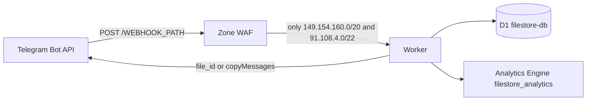

# Telegram FileStore Bot

[🇮🇷 مطالعه راهنمای فارسی (Persian Documentation)](./README.fa.md)

The same manual is split into a bilingual site under [`docs/`](./docs/index.md) and published on GitHub Pages. This file stays the single-page copy.

Production Telegram file-store bot for the Cloudflare Workers Free plan and one D1 database. Version **1.0.0**. No VPS, no paid Cloudflare product, no file bytes in the Worker.

> [!TIP]
> **Looking for the Telegram Serverless (@tgcloud/bot) Edition?**
> A dedicated standalone sister repository is available: [`telegram-uploader-bot`](https://github.com/AZiPA/telegram-uploader-bot), engineered specifically for Telegram's native serverless runtime (`@tgcloud/bot`) with zero external cloud dependencies.

This file is the operator manual: how the GitHub Actions pipeline creates and binds D1, which API token permissions the deploy actually needs, how to keep a custom domain across deploys, and how to run the bot.


---

## Contents

1. [Project overview and zero-cost architecture](#1-project-overview-and-zero-cost-architecture)
2. [Cloudflare setup](#2-cloudflare-setup)
3. [GitHub Actions secrets](#3-github-actions-secrets)
4. [Webhook registration](#4-webhook-registration)
5. [Custom domain and WAF hardening](#5-custom-domain-and-waf-hardening)
6. [Configuration (`src/config.ts` and live `/settings`)](#6-configuration-srcconfigts-and-live-settings)
7. [Commands and roles](#7-commands-and-roles)

---

## 1. Project overview and zero-cost architecture

One Worker (`telegram-filestore-bot`) receives Telegram updates, reads and writes a single D1 database (`filestore-db`), and emits counters to the Analytics Engine dataset `filestore_analytics`. Files never pass through the Worker. Delivery uses Telegram `file_id`, or `copyMessages` from a storage channel when `STORAGE_CHANNEL_ID` is set.



### Free-tier ceilings the bot is built around

Reset is 00:00 UTC. These are account-wide.

| Resource | Free ceiling | How this bot spends it |
|---|---|---|
| Worker requests | 100,000 / day | Each webhook update and each cron tick. The `* * * * *` trigger alone is 1,440 requests/day. |
| Worker CPU | 10 ms synchronous CPU per request (error 1102) | Await time on Telegram and D1 does not count. A multi-second delivery is legal. |
| Memory | 128 MB | No file buffers. |
| External subrequests | 50 / invocation | Bot API budget inside the code is 35. |
| Simultaneous outgoing connections | 6 | Force-join checks run in waves of at most 6. |
| Script size / startup | 64 MiB uncompressed, startup under 1 s | Cold start skips `getMe` (below). |
| D1 rows read | 5,000,000 / day | **Rows scanned, not rows returned.** |
| D1 rows written | 100,000 / day | One bundle is one row. |
| D1 storage | 5 GB | |
| Analytics Engine writes | 100,000 data points / day | Download counters and rare error signals. |

When the request cap is exceeded, Cloudflare returns **error 1027 at the edge**. The Worker does not run, so it cannot answer Telegram with HTTP 200. Telegram then retries for hours and can burn the next UTC day. The operator action is in [Webhook registration](#4-webhook-registration): `drop_pending_updates`, or remove the webhook, until 00:00 UTC.

`[observability]` in [wrangler.toml](wrangler.toml) stays commented out. Workers Logs and traces are not required and are left off so they are not turned on by a deploy.

### Single-row JSON, and the 96% write cut

`bundles` is one row per share code. Metadata for up to **25** files lives in the `items` TEXT column as a JSON array (`file_id`, `file_unique_id`, `type`, optional name, size, mime, `storage_message_id`). There is no `bundle_items` table and no `bundles.id`.

A 25-file bundle is **one** D1 write instead of 25 child-row writes. That is `1 − 1/25 = 96%` fewer item writes than a one-row-per-file model, at the maximum size the bot accepts. Edits of an existing bundle are still one write (the CAS below), not one write per file. Deleting a bundle is a two-statement batch, and it does **not** delete `user_downloads` (that table is the daily quota and the 7-day stats ledger; deleting it would refund quota and burn writes).

```sql
-- exact stored string, not a re-serialized parse
UPDATE bundles
SET items = ?
WHERE code = ? AND items = ?;
```

`bundles` has `created_at`, not `updated_at`. If `meta.changes` is 0, another request changed the document; the handler re-reads once or aborts. Deleting the last item deletes the bundle and its `bundle_votes` rows. It does not leave `items = '[]'`.

List, search, and stats queries do not select `bundles.items`. File counts use `json_array_length(items)`. Admin stats are cached in the isolate for 5 minutes.

### Six-socket pool

The platform allows 6 outgoing connections in flight per invocation. `Promise.all` over more than 6 `getChatMember` calls is not safe: extra sockets are not queued reliably. Force-join membership checks therefore run in waves of at most 6, and they fail closed on HTTP 429, timeout, or a transport error. Those calls count toward the 35 Bot API subrequest budget. The bot does not send an owner or log-channel alert from inside a user's membership check.

Delivery of mixed file types by `file_id` is sequential (one socket). `copyMessages` / `deleteMessages` are used when a storage channel or the deletion queue can address the messages in bulk.

### Cold start without `getMe`

There is **no `BOT_ID` secret**. On each isolate, `botIdFromToken()` in [src/shared/formatters.ts](src/shared/formatters.ts) reads the numeric id with `/^(\d+):/` from `BOT_TOKEN`. It does not split the token and it does not log it.

When that id and `BOT_USERNAME` are both present, [src/bot.ts](src/bot.ts) constructs grammY with a static `botInfo` (`id`, `username`, `first_name`, and the flags in `DEFAULT_BOT_INFO`). `isInited()` is then already true, so the webhook path does not call `getMe`. If either value is missing, grammY falls back to `init()`, which is an extra subrequest on the cold isolate. Set `BOT_USERNAME`.

### Roles, quotas, webhook contract

One D1 role per user: `owner`, `superadmin`, or `admin`. `MAX_ADMINS` (10) counts only `role = 'admin'`. The numeric `OWNER_ID` is always the owner, even before the seed row exists.

| Role | Daily cap | Per-link cap |
|---|---|---|
| Owner | none (no ledger row) | none |
| Admin | 150 | 20 |
| VIP, unexpired | `daily_download_limit × 5` | `file_daily_limit × 3` |
| Everyone else | `daily_download_limit` (default 10) | `file_daily_limit` (default 3) |

Dates are UTC `YYYY-MM-DD`. The SQL triggers `trg_user_downloads_limit_insert` / `_update` are the backstop for ordinary users (default 10/day) and they **exempt** rows in `admins` and unexpired `vips`. Admin and VIP numbers above are enforced in the application before the insert.

Wrong path or non-POST: **404**. Wrong `X-Telegram-Bot-Api-Secret-Token`: **403**. Handled updates, including errors the bot has classified: **200**, so Telegram does not retry into a dead database.

---

## 2. Cloudflare setup

Do these once, in the same Cloudflare account that will own the Worker. The GitHub workflow does not commit the database UUID.

### 2.1 D1 database `filestore-db`

The deploy job creates this database on the first run if it does not already exist. You can also create it yourself in the dashboard; either path works. The job never recreates a database that is already there.

1. Optional: Dashboard → **Storage & databases** → **D1 SQL** → **Create**, named exactly `filestore-db`. Leave location as you prefer if you create it by hand. CI will reuse that UUID and will **not** move it.
2. If you skip the dashboard, GitHub Actions calls `POST /accounts/{account_id}/d1/database` with `{"name":"filestore-db","primary_location_hint":region}` (defaults to `weur` — Western Europe). That hint applies only to databases this job creates.
3. The binding in [wrangler.toml](wrangler.toml) stays `database_id = "PLACEHOLDER_D1_ID"` in Git. CI rewrites the id only on the runner.
4. Do not paste [schema.sql](schema.sql) by hand. The job runs `wrangler d1 execute filestore-db --remote --file=./schema.sql -y`.

What the schema creates: `bundles`, `admin_sessions`, `bundle_votes`, `deletion_queue`, `admins` (`role` in `admin` / `superadmin` / `owner`), `vips`, `user_quotas` (bans and strikes, not a second download counter), `user_downloads`, `system_config`, `force_channels`, plus the indexes and the daily-limit triggers. Default config rows: maintenance off, daily limit 10, per-link limit 3, auto-delete 0, language `en`, global protect off. There is no default `log_channel_id` row, so Telegram logging stays off until a destination is configured.

### 2.2 What GitHub Actions does with that database

[`.github/workflows/deploy.yml`](.github/workflows/deploy.yml) runs on every push to `main` and on **Run workflow**. The job uses Node 24 and `npm install --legacy-peer-deps` (not `npm ci`: `package-lock.json` is gitignored). It typechecks with `tsc --noEmit`, then:

1. Reads `database_name` from `wrangler.toml`, unless you typed a custom name into the workflow form. Custom names are lowercased to kebab-case. Empty input keeps `filestore-db`.
2. Lists D1 databases with `GET /accounts/{account_id}/d1/database?name=...` and keeps the row whose `name` matches exactly.
3. If that list is empty, creates the database with `primary_location_hint` set to the resolved region hint (defaults to `"weur"`, or the value from `custom_db_region` / `vars.D1_LOCATION`). If create races with an existing row, it lists again and reuses the UUID. A failed list is a failed job. It does not guess and it does not call `wrangler d1 create`.
4. Masks that UUID in the Actions log (`::add-mask::`) and refuses to continue if the id is not a UUID.
5. `sed` writes `database_name` and `database_id` into the **checkout on the runner**. There is no commit and no push. `PLACEHOLDER_D1_ID` stays in Git.
6. Applies `schema.sql`, then the idempotent `admins.role` alter, then upserts `OWNER_ID` as `role = 'owner'`.
7. `npx wrangler deploy`, then secret injection. `STORAGE_CHANNEL_ID`, `LOG_CHANNEL_ID`, and `BOT_FIRST_NAME` are sent only when the GitHub secret is non-empty.

`npx wrangler d1 create --location=weur` is intentionally not used. Wrangler mixes banners into `--json`, prompts for a location on a TTY-less runner, and its `--location` flag is not the same contract as the API's `primary_location_hint`. `< /dev/null` only makes the prompt hit EOF.

`workflow_dispatch` inputs `custom_db_name`, `custom_db_region`, and `custom_worker_name` are optional. Leave them blank to keep defaults (`filestore-db`, `weur`, and `telegram-filestore-bot`). A custom database name is created in the specified region when it does not already exist.

#### D1 region selection & Telegram Data Center (DC) mapping

Cloudflare D1 supports six location hints: `weur` (Western Europe), `eeur` (Eastern Europe), `enam` (Eastern North America), `wnam` (Western North America), `apac` (Asia-Pacific), and `oc` (Oceania).

**Why `weur` (Western Europe) is the default:**
- Telegram's central Bot API gateway (`api.telegram.org`), webhook dispatchers (`149.154.160.0/20`, `91.108.4.0/22`), and European Data Centers (**DC2 & DC4**) are hosted in **Amsterdam, Netherlands (Western Europe)**.
- Because incoming Telegram webhooks hit Cloudflare's Western European edge colos, the Worker isolate and outgoing Bot API subrequests run in Western Europe. Placing D1 in `weur` keeps the Worker, D1 database, and Telegram Bot API co-located with minimal round-trip latency.

**Telegram DC reference mapping:**
If your bot creator account, primary user base, or storage channel resides in another Telegram Data Center, you can set `custom_db_region` (or set a repository variable `D1_LOCATION`) when creating a new database:
- **DC2 / DC4 (Europe — Amsterdam):** `weur` (Default — recommended for most bots) or `eeur`
- **DC1 / DC3 (Americas — Miami):** `enam` (or `wnam`)
- **DC5 (Asia-Pacific — Singapore):** `apac` (or `oc` for Oceania)

> [!NOTE]
> Cloudflare assigns `primary_location_hint` **only when initially creating a database**. An existing database is reused as-is and cannot be relocated between regions by changing workflow inputs.

### 2.3 Analytics Engine dataset `filestore_analytics`

You do not create this dataset by hand, and you must not rename it.

[wrangler.toml](wrangler.toml) already contains:

```toml
[[analytics_engine_datasets]]
binding = "FILESTORE_ANALYTICS"
dataset = "filestore_analytics"
```

Workers Analytics Engine creates the dataset the first time the Worker calls `writeDataPoint` on that binding. Deploying the binding does not require a separate Analytics permission. The binding name `FILESTORE_ANALYTICS` and the dataset name `filestore_analytics` are fixed.

After the first real metric write, the dataset shows up in the dashboard under **Workers & Pages** and **Analytics** → **Workers Analytics Engine**. If you want to query it with the SQL API (`POST /accounts/<id>/analytics_engine/sql`), that read token needs **Account Analytics Read**. The deploy token does not need that permission for the Worker to write points.

Do not uncomment `[observability]`. That block is Workers Logs / traces, not this dataset.

### 2.4 `CLOUDFLARE_API_TOKEN` from the "Edit Cloudflare Workers" template

Dashboard → **My Profile** → **API Tokens** → **Create Token** → template **Edit Cloudflare Workers** → **Use template**.

The template (Cloudflare's template table, last updated 2026-04-20) already grants:

| Template permission | Scope | Needed by this repo? |
|---|---|---|
| Workers Scripts → Write | Account | Yes. `wrangler deploy`, `wrangler secret put`, `wrangler secret bulk`. The row already says **Write**. Leave it. |
| Workers Routes → Write | Zone | Yes, once a custom domain or route is deployed. Leave it, and limit the zone to the bot's zone. |
| Account Settings → Read | Account | Yes. Wrangler reads the account. |
| User Details → Read | User | Yes. Keep it. |
| User Memberships → Read | User | Yes. Keep it even though `CLOUDFLARE_ACCOUNT_ID` is set. Wrangler still resolves membership. |
| Workers KV Storage → Write | Account | No. This bot has no KV binding. Harmless if left on. |
| Workers R2 Storage → Write | Account | No. No R2 binding. Harmless if left on. |
| Workers Tail → Read | Account | No. The workflow does not tail. Harmless if left on. |

**Add D1 under Account.** It is not in the template. On the token screen, under **Account Resources**, click **+ Add more**. The permission dropdown labels levels **Read** and **Write** only, the same way the template row is `Workers Scripts` → `Write`. There is no **D1 Edit** choice in that dropdown. Do not go looking for one.

| What you click | Why |
|---|---|
| Account → **D1** → **Write** | Required. REST list/create in the deploy job, and `wrangler d1 execute` for `schema.sql`, the `ALTER`, and the owner seed. |
| Account → **D1** → **Read** | Optional. Add it if you also want this token to run read-only D1 queries. **Write** is the grant this deploy needs. |
| Zone → **DNS** → **Write** (bot zone only) | Add if a deploy that declares a custom domain cannot create the proxied DNS record. Custom Domains normally create that record when **Workers Routes → Write** is already on the zone. If the API returns a DNS permission error, add **Write** here rather than switching to a Global API Key. |
| Account → **Account Analytics** → **Read** | Optional. Only for SQL queries against `filestore_analytics`. Not required to deploy or to write data points. |

**Resource scope.** One account, not "all accounts". Zone resources: only the zone that will serve the custom domain, not every zone in the account. Do not grant API Tokens Write, and do not use the Global API Key.

**First deploy of a Worker that does not exist yet.** As of the Workers roles model (2026-09-15), `wrangler deploy` of a **new** script needs product-level **Workers Admin**. Deploying an **existing** script, and `wrangler secret put` / `secret bulk`, need **Workers Scripts → Write**, which the template already includes. Binding D1 on deploy needs that same Workers Scripts grant. **D1 → Write** is required because this workflow queries and migrates D1 directly, not because the binding exists.

Practical sequence if the first run says the token cannot create a script:

1. Dashboard → **Workers & Pages** → **Create** → name it exactly `telegram-filestore-bot` (empty script is enough), **or** add product-level Workers Admin to the token for that first run.
2. Re-run the workflow. Later deploys and secret injection stay on **Workers Scripts → Write**.
3. You can drop Workers Admin after the script exists if you do not want CI to be able to delete Workers.

**Analytics Engine and this token.** Writes go through the Worker binding at runtime and do not use `CLOUDFLARE_API_TOKEN`. No extra permission is required for the dataset to be created on first write. A token that is missing **D1 → Write** fails on the D1 REST list/create or on `wrangler d1 execute`, not at Analytics Engine. The same token is what creates `filestore-db` in `weur` when it does not already exist.

Copy the token once. Store it as the GitHub secret `CLOUDFLARE_API_TOKEN`. It is not a Worker binding and it must not be written into `wrangler.toml` or `src/`.

### 2.5 `CLOUDFLARE_ACCOUNT_ID`

Dashboard → **Workers & Pages** → right-hand account panel, or any dashboard URL:

```text
https://dash.cloudflare.com/<ACCOUNT_ID>/workers/overview
```

`<ACCOUNT_ID>` is a 32-character hex id. Store it as `CLOUDFLARE_ACCOUNT_ID`. The workflow passes it to Wrangler as `CLOUDFLARE_ACCOUNT_ID`. This is not a secret in the cryptographic sense, but it is still a GitHub Actions secret in this repo so it is not committed.

---

## 3. GitHub Actions secrets

Repository → **Settings** → **Secrets and variables** → **Actions** → **New repository secret**.

`BOT_ID` is **not** a secret and must not be created. The numeric id is derived at runtime from `BOT_TOKEN`.

### Required

| Secret | Purpose |
|---|---|
| `CLOUDFLARE_API_TOKEN` | Wrangler deploy, D1, and secret injection. Section 2.4. |
| `CLOUDFLARE_ACCOUNT_ID` | Account the Worker and D1 live in. |
| `BOT_TOKEN` | From BotFather. Injected into the Worker. Never log it. The id prefix is parsed locally; the rest of the token is not split or stored separately. |
| `BOT_USERNAME` | Without `@`. Together with the derived id, this skips `getMe` on cold start. The workflow does not fail the job when this is empty; set it anyway. |
| `OWNER_ID` | Numeric Telegram user id of the owner. Seeded into `admins` as `role = 'owner'` on every deploy. Runtime also treats this id as owner even if the row is missing. |
| `WEBHOOK_PATH` | Secret path segment, no leading slash. The Worker accepts only `POST /<WEBHOOK_PATH>`. A guessable path (`webhook`, `bot`) makes the WAF rule the only thing hiding the Worker. Use a long random string. |
| `WEBHOOK_SECRET` | Sent to Telegram as `secret_token` and checked against `X-Telegram-Bot-Api-Secret-Token`. Strictly enforced (fail-closed): the CI workflow (`.github/workflows/deploy.yml`) exits if missing or < 16 characters; the Worker (`src/index.ts`) returns HTTP 403 if unset or mismatched. |

The job's hard fail list (it exits before D1 provision) is `WEBHOOK_PATH`, `BOT_TOKEN`, `OWNER_ID`, `CLOUDFLARE_API_TOKEN`, `CLOUDFLARE_ACCOUNT_ID`, and `WEBHOOK_SECRET` (fails closed if missing or < 16 characters; Worker returns HTTP 403 if unset or mismatched). `BOT_USERNAME` is still required for static bot info.

### Optional

| Secret | Purpose |
|---|---|
| `STORAGE_CHANNEL_ID` | Numeric id of a channel where the bot is admin (usually `-100...`). On upload, the bot `copyMessage`s each file there and stores `storage_message_id`. Delivery then uses bulk `copyMessages` from that channel. If the secret is omitted, delivery sends each item by `file_id`, one request at a time. The bot does not proxy file bytes in either mode. |
| `LOG_CHANNEL_ID` | Optional default Telegram log channel (`-100…`). Used only when `system_config.log_channel_id` is empty. Omitted secret + empty D1 row = Telegram logging off (no Bot API log calls, no log writes, nothing sent to `OWNER_ID`). `/setlogchannel off` stores `off` and wins over this secret. `/setlogchannel owner` routes logs to the owner's private chat. Factory reset is the only path that falls back to `OWNER_ID` when no log target resolves. |
| `BOT_FIRST_NAME` | Optional display name baked into static `botInfo`. If omitted, the cold-start name is `File Store Bot` from `DEFAULT_BOT_INFO`. Not required. The workflow injects it only when it is non-empty. |

Empty optional secrets are omitted from `wrangler secret bulk`. They are not pushed as blank values.

Worker runtime secrets are only: `BOT_TOKEN`, `BOT_USERNAME`, `BOT_FIRST_NAME`, `WEBHOOK_PATH`, `WEBHOOK_SECRET`, `OWNER_ID`, `STORAGE_CHANNEL_ID`, `LOG_CHANNEL_ID`. `CLOUDFLARE_API_TOKEN` and `CLOUDFLARE_ACCOUNT_ID` stay on GitHub.

---

## 4. Webhook registration

Deploy the Worker at least once so the domain answers, then register the webhook. Telegram must call:

```text
https://<YOUR_DOMAIN>/<WEBHOOK_PATH>
```

`<YOUR_DOMAIN>` is the custom domain from section 5, not `*.workers.dev`. `<WEBHOOK_PATH>` is the secret value with no extra slash.

`max_connections` is how many updates Telegram will push at once. The default is 40. This bot sets **8**: the daily budget is 100,000 requests, and the cron already uses 1,440 of them. A viral deep link with the default of 40 can drain the quota in an afternoon. Eight in flight is enough for a small public bot and keeps a flood from scheduling the whole day in one hour.

`allowed_updates` is only `message` and `callback_query`. The bot does not handle inline queries, channel posts, or poll results. Extra types would still invoke the Worker.

Prefer curl so the token does not land in browser history. Replace the variables locally. Do not commit the command with real values.

```bash
curl -sS "https://api.telegram.org/bot${BOT_TOKEN}/setWebhook" \
  --data-urlencode "url=https://<YOUR_DOMAIN>/${WEBHOOK_PATH}" \
  --data-urlencode "secret_token=${WEBHOOK_SECRET}" \
  -d "max_connections=8" \
  --data-urlencode 'allowed_updates=["message","callback_query"]' \
  -d "drop_pending_updates=true"
```

The same call in a browser (token will be stored in history; avoid this on a shared machine):

```text
https://api.telegram.org/bot<BOT_TOKEN>/setWebhook?url=https://<YOUR_DOMAIN>/<WEBHOOK_PATH>&secret_token=<WEBHOOK_SECRET>&max_connections=8&allowed_updates=%5B%22message%22%2C%22callback_query%22%5D&drop_pending_updates=true
```

A correct response contains `"ok": true` and `"description": "Webhook was set"`.

### Verify

```bash
curl -sS "https://api.telegram.org/bot${BOT_TOKEN}/getWebhookInfo"
```

```text
https://api.telegram.org/bot<BOT_TOKEN>/getWebhookInfo
```

Check:

- `url` is `https://<YOUR_DOMAIN>/<WEBHOOK_PATH>`
- `has_custom_certificate` is false (Cloudflare's edge certificate is public and valid)
- `pending_update_count` is 0, or falling, after a test `/start`
- `max_connections` is 8
- `allowed_updates` is `["message","callback_query"]`
- `last_error_message` is empty. A 403 here means `WEBHOOK_SECRET` ≠ `secret_token`. A 404 means the path does not match `WEBHOOK_PATH`.

Smoke test from any machine that is **not** Telegram (expect **403** if the secret header is wrong, **404** if the path is wrong):

```bash
curl -sS -o /dev/null -w "%{http_code}\n" -X POST "https://<YOUR_DOMAIN>/<WEBHOOK_PATH>"
curl -sS -o /dev/null -w "%{http_code}\n" -X POST "https://<YOUR_DOMAIN>/<WEBHOOK_PATH>" \
  -H "X-Telegram-Bot-Api-Secret-Token: wrong"
```

Both should be `403` when `WEBHOOK_SECRET` is set (missing header and wrong header are the same check). A wrong path should be `404`. Then send `/start` to the bot and confirm `getWebhookInfo` shows a recent successful delivery.

### Clear a backlog (`drop_pending_updates`)

Use this when `pending_update_count` is large, after a bad deploy, or when Cloudflare has started returning **error 1027**. Those retries are themselves requests and will consume the next day's quota if they are still queued at 00:00 UTC. The Worker cannot see 1027 and cannot drop the queue itself.

Re-register the same URL and drop what is pending:

```bash
curl -sS "https://api.telegram.org/bot${BOT_TOKEN}/setWebhook" \
  --data-urlencode "url=https://<YOUR_DOMAIN>/${WEBHOOK_PATH}" \
  --data-urlencode "secret_token=${WEBHOOK_SECRET}" \
  -d "max_connections=8" \
  --data-urlencode 'allowed_updates=["message","callback_query"]' \
  -d "drop_pending_updates=true"
```

To stop delivery entirely until the quota resets:

```bash
curl -sS "https://api.telegram.org/bot${BOT_TOKEN}/deleteWebhook" \
  -d "drop_pending_updates=true"
```

Call `setWebhook` again after 00:00 UTC. Confirm with `getWebhookInfo` that `pending_update_count` is 0.

---

## 5. Custom domain and WAF hardening

### Why the `workers.dev` hostname has to go

A new Worker is published at `<name>.<account-subdomain>.workers.dev`. That hostname is public, it is not behind your zone's WAF, and every scanner that finds it spends the 100,000 request/day quota. HTTP 404 from the Worker still counts as a request. Error 1027 only appears after the quota is already gone.

A custom domain on a zone you control is what lets you drop non-Telegram traffic **before** the Worker runs. Blocked WAF requests are not Worker invocations. They do not consume the daily request quota. Cron ticks and real Telegram updates still do.

### Make every GitHub Actions deploy keep that choice

The committed [wrangler.toml](wrangler.toml) does **not** set `workers_dev` and does **not** declare a route. Wrangler's default is `workers_dev = true` when the file has no routes. The next `npx wrangler deploy` from Actions will turn `*.workers.dev` back on if you only disabled it in the dashboard.

Cloudflare's rule for routes is the opposite problem: **routes in the dashboard are replaced on the next deploy by whatever `routes` the file contains.** A custom domain that exists only in the dashboard can be removed by a deploy that does not mention it. A file that sets `workers_dev = false` and has **no** `routes` key leaves dashboard routes alone. A file that sets `routes` becomes the source of truth.

Use the file as the source of truth so a deploy cannot re-enable `workers.dev` and cannot drop the hostname. Add both, with your real hostname, and commit them:

```toml
# Disable the public workers.dev route on every deploy.
workers_dev = false

# Re-attach the custom domain on every deploy. Hostname only; the secret
# path is WEBHOOK_PATH, not part of this route.
routes = [
  { pattern = "bot.example.com", custom_domain = true }
]
```

> [!WARNING]
> **TOML key placement:** In TOML syntax, any key placed after a table header belongs to that table. `workers_dev = false` and `routes = [...]` **must** be placed at the top level of `wrangler.toml` **above** the first `[[d1_databases]]` or `[[analytics_engine_datasets]]` table header (e.g., right under `compatibility_flags`). If placed at the bottom of the file, TOML associates them with the preceding array of tables and Wrangler will ignore or reject them.

Replace `bot.example.com` with a hostname on a zone that is on **this** Cloudflare account (the zone must already be active). Do not put `PLACEHOLDER` here and deploy.

Then:

1. Confirm the API token includes **Workers Routes → Write** on that zone (the template has it; narrow the zone).
2. Push to `main`, or run the workflow.
3. Wrangler creates the custom hostname, the proxied DNS record, and the certificate. If the API complains about DNS, add **DNS → Write** on that zone and re-run. You do not manage the certificate yourself.
4. Dashboard → **Workers & Pages** → `telegram-filestore-bot` → **Settings** → **Domains & Routes**.
   - Custom domain: your hostname, status active.
   - `workers.dev`: **Disabled**.
5. Register the webhook against `https://bot.example.com/<WEBHOOK_PATH>` only after the certificate is active.

**After every later deploy, check the same screen.** With the snippet committed, each Actions run writes `workers_dev = false` and the same custom domain again, so the dashboard should still show workers.dev off and the custom domain present. If someone removes `workers_dev = false` or deletes the `routes` entry, the following deploy puts the public hostname back or drops the domain. If you add a second hostname only in the dashboard, the next deploy removes it, because the file does not list it.

Do not point Telegram at `workers.dev` "just until DNS works". Scanners will keep that URL after you think you have moved.

Local `wrangler dev` is unaffected. `workers_dev = false` only changes the deployed route.

### Security rule: Telegram's IPv4 ranges only

Open the zone (the domain), not the Workers overview. The current dashboard has no **Security → WAF → Custom rules** item. The path is:

**Select the domain → Security → Security rules → Create rule → Custom rules.**

- Name: `telegram-webhook-only`
- Action: **Block**
- Deploy / Save.

Two expressions are valid. Both use the Bot API webhook IPv4 ranges `149.154.160.0/20` and `91.108.4.0/22`. Put the rule above any Skip rule that would exempt the hostname.

**Option A — block non-Telegram clients only on the webhook path.** Other paths on the same zone stay open, so a normal site on this domain is not locked. Replace the path with your real `WEBHOOK_PATH`, including the leading slash:

```text
(http.request.uri.path eq "/REPLACE_WITH_WEBHOOK_PATH" and not ip.src in {149.154.160.0/20 91.108.4.0/22})
```

What it does: a request whose path is exactly the webhook path, and whose source IP is outside those ranges, is blocked at the edge. The Worker is not invoked. That request does not spend the 100,000/day quota. Telegram's webhook calls match the IP list and are allowed through. The Worker still checks `X-Telegram-Bot-Api-Secret-Token`. Scanners that hit `/` or some other path are not blocked by this option.

**Option B — block every request to the bot hostname unless the IP is Telegram.** Use this when the hostname serves only the bot and you want random paths blocked too, not just the secret path. Replace the host:

```text
(http.host eq "bot.example.com" and not ip.src in {149.154.160.0/20 91.108.4.0/22})
```

Same action: **Block**. Anything to that subdomain from outside `ip.src in {149.154.160.0/20 91.108.4.0/22}` never reaches the Worker. Do not use option B on a hostname that also serves a website you open from a browser. To combine both (bot host and webhook path only):

```text
(http.host eq "bot.example.com" and http.request.uri.path eq "/REPLACE_WITH_WEBHOOK_PATH" and not ip.src in {149.154.160.0/20 91.108.4.0/22})
```

This rule does nothing for `*.workers.dev`. That hostname is not in your zone, so **Security rules** never sees it. That is why this section disables the workers.dev route in `wrangler.toml`.

After you save the rule, the curl smoke test from your laptop to the real path should return Cloudflare's block page (or HTTP 403 from the edge rule), not the Worker's 403. `getWebhookInfo` should still show successful deliveries, because Telegram's IPs match the allow exception.

If a future Telegram network change starts failing `last_error_message` with a connection timeout or a Cloudflare block, re-check Telegram's published webhook ranges before widening this rule to `0.0.0.0/0`.

---

## 6. Configuration (`src/config.ts` and live `/settings`)

Source of the constants: [src/config.ts](src/config.ts). Live operator settings are rows in D1 `system_config`, edited from Telegram with `/settings` (alias `/botconfig`). Live changes do not need a deploy. A constant in `src/config.ts` changes only after you edit the file and the workflow deploys it.

`getDynamicConfig()` caches each `system_config` key in the isolate for **60 seconds**. Writes from `/settings` clear that cache on the isolate that handled the command. Another isolate can serve the previous value until its 60 seconds end.

### `PROJECT_CONFIG`

| Constant | Value | What it actually controls |
|---|---|---|
| `DEFAULT_WORKER_NAME` | `telegram-filestore-bot` | Documents the Worker name. The workflow reads `name` from `wrangler.toml`, not this constant. A workflow form can override the toml name for that run only. |
| `DEFAULT_DB_NAME` | `filestore-db` | Documents the D1 name. The workflow reads `database_name` from `wrangler.toml`. |
| `ANALYTICS_DATASET_NAME` | `filestore_analytics` | Documents the dataset name. The binding that matters is the one in `wrangler.toml`. Do not rename one without the other. |

### `LIMITS`

All of these are live and require a deploy to change.

| Constant | Value | Effect |
|---|---|---|
| `MAX_FORCE_JOIN_CHANNELS` | 8 | Maximum active force-join channels. |
| `FORCE_JOIN_THROTTLE_SEC` | 3 | Minimum gap between a user's force-join re-checks. |
| `DEFAULT_DAILY_DOWNLOADS` | 10 | Fallback when `system_config.daily_download_limit` is missing. The live number is the D1 row, edited with `/setdailylimit`. |
| `DEFAULT_FILE_DAILY_LIMIT` | 3 | Fallback when `file_daily_limit` is missing. Live number is `/setfilelimit` (owner). |
| `RATE_LIMIT_BURST` | 3 | Non-admin messages allowed inside the window. The next one is muted. |
| `RATE_LIMIT_WINDOW_SEC` | 5 | Window for that burst. Mute length is 60 seconds, hardcoded in `rate_limit.ts`, and it exists only on that isolate. |
| `MAX_BUNDLE_ITEMS` | 25 | Maximum files stored in one bundle JSON document. |
| `MAX_PER_SESSION_UPLOAD` | 20 | Maximum files accepted in one `/batch` session. Also capped by `MAX_BUNDLE_ITEMS`. |
| `CHUNK_DELIVERY_SIZE` | 10 | Files sent per delivery step. The next chunk is a button, which is another update, so a 25-file bundle is three Worker invocations, not one giant fan-out. |
| `MAX_ADMINS` | 10 | Maximum rows with `role = 'admin'`. Super admins and the owner are not counted. |
| `MAX_PASSCODE_ADMIN` | 5 | Maximum active password-protected bundles created by a regular Admin. |
| `MAX_PASSCODE_SUPERADMIN` | 15 | Maximum active password-protected bundles created by a Super Admin. |
| `OWNER_PASSCODE_WARN_THRESHOLD` | 20 | Advisory warning threshold for Owner password-protected bundles. |
| `MAX_ROTATING_ADMIN` | 3 | Maximum active rotating bundles created by a regular Admin. |
| `MAX_ROTATING_SUPERADMIN` | 10 | Maximum active rotating bundles created by a Super Admin. |
| `MAX_ROTATING_PER_CHANNEL` | 10 | Maximum active rotating bundles pointing to a single channel. |
| `OWNER_ROTATING_WARN_THRESHOLD` | 20 | Advisory warning threshold for Owner rotating bundles. |
| `POST_SYNC_COOLDOWN_SEC` | 300 | Cooldown in seconds (5m) for non-owner admins between channel post sync/rotations. |
| `OWNER_SYNC_WARN_COOLDOWN_SEC` | 60 | Cooldown in seconds (1m) before owner advisory notice on channel post sync. |

### `QUOTA_CACHE_CONFIG`

Used by delivery as a same-isolate hint that a user is already over the daily cap, so a repeat click does not have to hit D1 first. It is not the quota authority. The ledger write is.

| Field | Value | Effect |
|---|---|---|
| `enabled` | `true` | Turn the hint on. Set the Worker secret `ENABLE_QUOTA_CACHE` to the string `false` to disable it without editing code. The GitHub workflow does not set that secret. |
| `ttlMs` | 5 minutes | How long a "daily cap reached" hint lives in this isolate. |
| `maxEntries` | 1000 | Cap on the map. A full map evicts so the isolate cannot grow it without bound. |
| `alertCooldownMs` | 15 minutes | Kept for the quota-cache warning. That warning goes through `LoggerService` and this cooldown, not a direct `LOG_CHANNEL_ID` send. |

`DEFAULT_BOT_INFO` is the static grammY identity used on the cold path (cannot join groups, no inline mode, and the other flags). `first_name` falls back to `File Store Bot` unless `BOT_FIRST_NAME` is set.

### Live `/settings` (no deploy)

`/settings` and `/botconfig` are Super Admin and Owner commands. The message shows the current D1 values. Owner-only rows are hidden from Super Admins.

| What | Who | How | D1 key |
|---|---|---|---|
| Daily download cap for ordinary users | Super Admin, Owner | Button on `/settings`, or `/setdailylimit <count>` | `daily_download_limit` |
| Default channel for bundle posts | Super Admin, Owner | `/setpubchannel <-100…|off|clear>` | `publish_channel_id` |
| Telegram log channel | Owner | `/setlogchannel` with a channel id, `owner`, or `off` | `log_channel_id` (`off` disables even if `LOG_CHANNEL_ID` is set; empty uses the secret; missing both is off) |
| Bot profile (name, description, short description) | Super Admin, Owner | `/botprofile` or the profile button | Telegram, not D1 |
| Per-link cap | Owner | `/setfilelimit <count>` | `file_daily_limit` |
| Auto-delete of delivered messages | Owner | `/setautodel <seconds>` (`0` disables), or the button, which cycles `0 → 60 → 300 → 600 → 1800 → 3600` | `auto_delete_seconds` |
| Default bundle expiry TTL | Owner | `/setbundlettl <seconds|presets>`, or button, cycling `0 → 1h → 6h → 24h → 7d → 30d` | `default_bundle_ttl_seconds` |
| Maintenance mode | Owner | `/maintenance` or `/maint`, or the button | `maintenance_mode` (`0` / `1`) |
| Default language | Owner | Button toggles `en` / `fa` | `default_language` |
| Global protect content | Owner | Button | `global_protect_content` (`0` / `1`) |

Maintenance mode blocks non-admins. Admins, super admins, and the owner still get through.

Language selection, in order: if the Telegram `language_code` starts with `fa`, the user gets Persian. Otherwise they get Persian only when `default_language` is `fa`, and English in every other case.

Auto-delete `0` means the cron does not queue those messages. Any other value is seconds until the minute cron calls `deleteMessages`. The cron reads at most 25 queue rows per minute and stops at 35 Bot API calls or the first 429.

These are also live, but they are not on the `/settings` screen:

| Command | Who | Effect |
|---|---|---|
| `/setverifybtn <label>` | Admin | Force-join verify button label. Key `cfg_fj_verify_btn`. |
| `/setchannelbtn <channel_id> <label>` | Admin | Button label for one force-join channel (2–40 characters). |

VIP multipliers and the admin 150/20 caps are code, not `/settings`. Changing the daily limit scales VIP (`× 5` and `× 3`) and does not change the admin caps.

---

## 7. Commands and roles

Rank, highest first: **Owner > Super Admin > Regular Admin > VIP > User**. One row per user in `admins`. A person is not both super admin and admin. VIP is a separate table (`vips`), not an admin role.

`command_guard` lets the owner call every command. Everyone else is limited to the set for their rank. A callback is not a command: mutating buttons check the role themselves.

The owner is `OWNER_ID`, and also any `admins.role = 'owner'` row. CI keeps `OWNER_ID` on `owner`. Commands cannot ban, demote, or remove that id.

### Owner

Everything below, plus:

| Command | Effect |
|---|---|
| `/maintenance`, `/maint` | Toggle maintenance mode. |
| `/resetfactory confirm`, `/factoryreset confirm` | Sends a JSON backup (config, force-join channels, bundle count, admin count) to the log channel, or to `OWNER_ID` if no log channel resolves. Aborts if that send fails. Then deletes `bundles`, `bundle_votes`, `admin_sessions`, `deletion_queue`, `user_quotas`, `user_downloads`, `force_channels`, and `vips`. **Does not delete `admins` or `system_config`.** Parameter `confirm` is required. |
| `/restore` | Reply to a backup `.json` document (up to 256 KB) to restore `system_config` entries and `force_channels` in a single atomic batch write. |
| `/setautodel <0 | 10..172800>` | Auto-delete delay in seconds (`0` off, or `10..172800` up to 48 hours). |
| `/setbundlettl <0|off|1h|6h|24h|7d|30d|seconds>` | Default expiration TTL applied to newly uploaded bundles (`0` disables). |
| `/setfilelimit <count>` | Per-link daily cap for ordinary users. |
| `/setlogchannel <target>` | Log destination. Channel id, `owner`, `me`, `off`, `disable`, or `clear`. See [Live /settings (no deploy)](#live-settings-no-deploy). |
| `/addadmin <user_id> superadmin` | Only the owner may grant `superadmin`. |

Owner downloads are not written to `user_downloads` and are not capped.

### Super Admin

Owner commands above are refused. Super Admin can manage regular admins and cannot manage the owner or another super admin (`roleRank` / `outranks`).

| Command | Effect |
|---|---|
| `/settings`, `/botconfig` | Settings menu. Daily limit, publish channel, and bot profile. Owner-only toggles are not shown. |
| `/setdailylimit <count>` | Ordinary-user daily cap. |
| `/setpubchannel <channel_id|off|clear>` | Set default channel ID for bundle posts and link rotation. |
| `/botprofile` | Name, description, short description. |
| `/admins` | List super admins and regular admins. Shows the regular-admin count against 10. |
| `/addadmin <user_id>` | Add a regular admin, or change a lower role to admin. Fails at 10 regular admins. |
| `/addadmin <user_id> superadmin` | Refused. Owner only. |
| `/deladmin <user_id>`, `/removeadmin <user_id>` | Remove a user this caller outranks. |
| `/ban <user_id> [1..3650]` | Ban for 1 to 3650 days (default **30** days). Cannot target the owner or a peer/higher role. |
| `/unban <user_id>` | Clear `banned_until` and strikes. |
| `/addvip <user_id> [days]` | VIP. Omit days or pass `0` for no expiry (`expires_at = 0`). |
| `/vips` | List active VIP members with inline controls (Refresh, Clear All). |
| `/delvip <user_id>`, `/removevip <user_id>` | Remove VIP status for a specific user. |
| `/delvip all`, `/clearvips` | Clear all VIP members with confirmation prompt. |

Plus every Regular Admin command.

### Regular Admin

Refused for Super Admin and Owner commands.

| Command | Effect |
|---|---|
| `/upload` | One file. The next file you send becomes a one-item bundle and returns a `t.me` deep link. |
| `/batch` | Up to 20 files (and at most 25 in the document). |
| `/done` | Close a batch (writes one `bundles` row) or leave edit mode. |
| `/cancel` | Drop the open session. |
| `/edit <code>`, `/manage <code>`, `/review <code>` | Bundle hub for an 8–36 character code. Item removal uses compare-and-swap on `items`. Respects hierarchical ownership lock (`owner_locked`). |
| `/setexpiry <code> <duration>` | Set bundle expiration timer (`0`, `off`, `1h`, `6h`, `24h`, `3d`, `7d`, `30d`, or seconds). |
| `/setpass <code> <pin|off|clear>` | Set PIN passcode (4-32 alphanumeric chars, enforces content protection) or clear it. |
| `/postbundle <code> [channel_id]` | Publish or sync bundle post with download button to default or target channel. |
| `/rotatelink <code>` | Rotate bundle UUID link immediately, update channel post, and invalidate prior link. |
| `/setname <code> <title>` | Search title. `/setname <code> clear` removes it. Protected bundles cannot take a title. |
| `/search <text>`, `/find <text>` | Admin search by title. At least 2 characters. Limit 10. Does not load `items`. |
| `/stats`, `/status` | Bundle count, file count (`json_array_length`), download sum. Cached 5 minutes. |
| `/top`, `/topfiles` | Top 5 codes by downloads in that same snapshot. |
| `/channels`, `/fjmenu`, `/forcejoin` | Force-join menu. |
| `/addchannel` | See the syntax below. |
| `/delchannel <channel_id>` | Remove a channel and revoke its invite link. |
| `/setchannelbtn <channel_id> <label>` | Channel button label, 2–40 characters. |
| `/setverifybtn <label>` | The "I have joined" button label. |

`/addchannel` syntax:

- Reply to a forwarded channel post with `/addchannel [member_limit] [button label]`, or
- `/addchannel <channel_id> [member_limit] [button label]`

The channel id must look like `-100...`. The bot must be an administrator there and must be allowed to invite users. `member_limit` of `0` or omitted keeps a permanent link (public `t.me` username, or the existing link). A positive limit creates a new invite link with that member cap. At most 8 channels.

Admin download caps are 150/day and 20 per link per day, independent of `/setdailylimit`.

### VIP

No admin commands. Same user surface as a normal user. While `expires_at` is `0` or still in the future, caps are five times the daily limit and three times the per-link limit. Super Admins can list active VIPs via `/vips`, revoke a single user's VIP status via `/delvip <user_id>` (or `/removevip <user_id>`), or clear all VIPs via `/delvip all` or `/clearvips`. Factory reset deletes `vips` and does not delete `admins`.

### User

| Command | Effect |
|---|---|
| `/start` | Short welcome. |
| `/start <code>` | Deliver that bundle, after force-join (if configured) and quota checks. |
| `/start <code>_<pin>` | Deliver password-protected bundle in a single step. |
| `/help` | How to use a deep link, and the force-join note. |

Any other command is ignored with no reply. Opening an admin deep link as a non-admin delivers the files instead of the admin hub. Banned users (`user_quotas.banned_until`) are dropped. The ban flag is cached per isolate for up to 60 seconds; `/unban` clears it on the isolate that handled the command.

Non-admins are also limited to 3 updates in 5 seconds on a single isolate, then a 60-second local mute. That mute is not a D1 ban and does not follow the user to another isolate.

---

## Deploy checklist

1. D1 database `filestore-db` exists or will be created by Actions in `weur` on the first run. Git still says `PLACEHOLDER_D1_ID`. A database you already created in the dashboard is reused and is not moved.
2. `wrangler.toml` has `workers_dev = false` and the custom domain `routes` entry. `[observability]` is still commented out.
3. GitHub secrets from section 3 are set. There is no `BOT_ID` secret.
4. The API token has the template grants (**Workers Scripts → Write** and the rest) plus **Account → D1 → Write**. There is no "D1 Edit" label on that screen.
5. The Security rule was created under the domain's **Security → Security rules** (Custom rules), with one of the two expressions in section 5, and it matches the real webhook path or bot hostname plus `149.154.160.0/20` and `91.108.4.0/22`.
6. `getWebhookInfo` matches the custom domain, `max_connections` is 8, and a live `/start` returns 200.
7. Domains & Routes still shows the custom domain up and `workers.dev` down after the latest Actions run.
